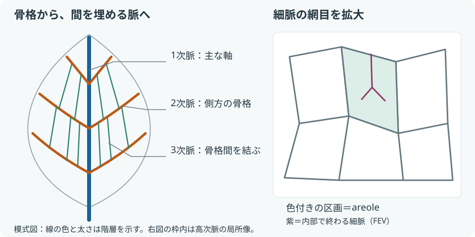
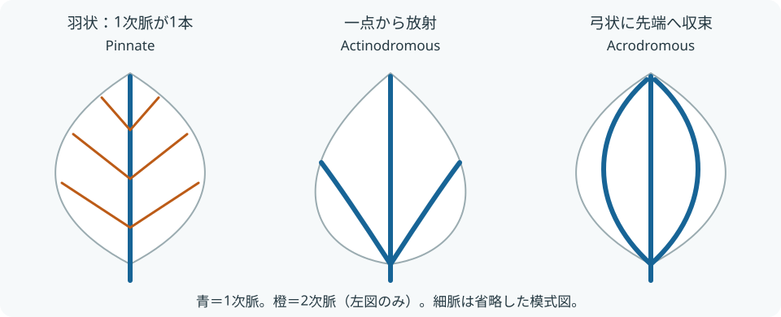
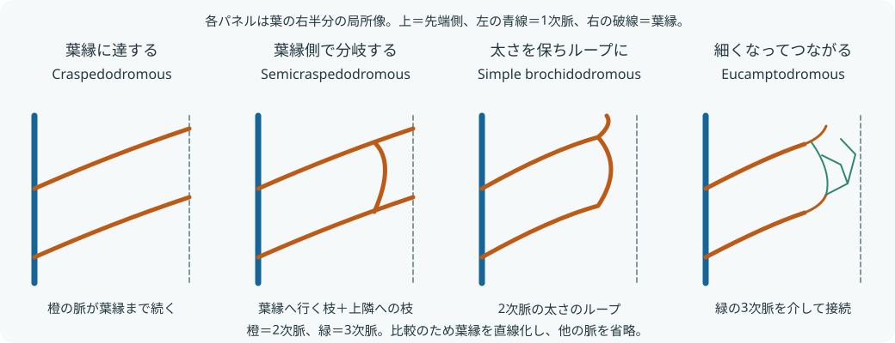

葉脈を見分けるときは、まず**太い骨格を探し、次にその間を埋める網目を見る**と整理しやすくなります。
このページは *Manual of Leaf Architecture* のうち、主に網状脈をもつ広葉樹の葉を観察するための入門ガイドをまとめたものです。

最初に、次の2つを分けて考えます。

| 知りたいこと | 観察するもの | 記録例 |
|---|---|---|
| **次数（order）**：この脈は骨格のどの階層か？ | 太さ、走行、他の脈との関係 | 1次脈、2次脈、3次脈 |
| **脈系の型（framework / fabric）**：脈がどのように配置されるか？ | 放射する、葉縁に達する、ループを作る、網目を作る | 羽状、craspedodromous、reticulate |

たとえば「1次脈は羽状配置、2次脈は葉縁でループを作り、3次脈は網状」というように、**階層ごとに記述**します。

## 1. 観察する順序

1. **全体を見る。** 葉柄の付く位置、葉の基部・先端・葉縁を確認します。部分画像だけでは、太い脈が1次脈か2次脈か分かりにくくなります。
2. **最も太い脈を探す。** 葉の中心や基部など、脈が太く現れる場所で比較します。先端で細くなった部分だけを比べないようにします。
3. **骨格の間を埋める、最も太い網目を探す。** 多くの葉ではこれが3次脈です。1次脈と3次脈が見えると、その中間の骨格である2次脈を整理できます。
4. **2次脈を葉縁まで追う。** 葉縁へ達するか、隣の2次脈とつながるか、細くなって網目に入るかを見ます。
5. **拡大して細脈を見る。** 3次脈の配置、4次以上の脈、閉じた最小の網目、内部で終わる細脈を確認します。

葉裏や透過光で見やすさを確かめ、必要に応じて透過標本や拡大画像を使います。細脈が見えないときは「ない」ではなく「この画像では判定できない」と記録します。この観察上の扱いは本ページの実務上の提案です。次数判定の基本は原典 pp. 47–56 に基づきます。

## 2. 1次・2次・3次脈を見分ける

{#fig-vein-orders width=900 fig-alt="左は中央の太い1次脈、葉縁へ向かう2次脈、その間を結ぶ3次脈。右は細脈に囲まれたareoleと、その内部で終わるFEV。"}

| 次数 | 見分ける手掛かり | 注意点 |
|---|---|---|
| **1次脈（primary vein）** | 最も太い骨格。通常は基部付近から先端方向へ走り、途中で徐々に細くなる | 中央の主脈1本だけとは限らない。側方にも1次脈がある葉がある |
| **2次脈（secondary vein）** | 1次脈より細く、3次脈より太い骨格。主要な2次脈は1次脈から葉縁方向へ走る | 複数の太さ・走行の組を含む。すべてが葉縁に達するわけではない |
| **3次脈（tertiary vein）** | 骨格の間を広く埋める脈のうち、最も太い組。2次脈同士や1次脈と2次脈を結ぶことが多い | 走行中の太さは比較的一様。網状だけでなく、梯子の横木のような配置もある |
| **4次以上** | 3次脈よりも細かな網目を構成する組を、太さと走行を見ながら順に区別する | すべての葉で明瞭に分けられるわけではない。無理に番号を付けない |

原典では多くの被子植物の葉に4–7段階の次数を認めていますが、次数間の境界は必ずしも明瞭ではありません。また、葉全体の「場」を埋める脈が3次脈ではなく2次脈である例もあります（原典 pp. 47–56、特に p. 53、Fig. 147）。

::: {.callout-important title="分岐するたびに次数が1つ増えるわけではない"}
葉脈の次数は、**分岐回数や、端から数えたグラフの階層とは別の分類**です。太さと走行を組み合わせて判断します。同程度の太さで二叉に分かれた脈は、分かれた後も同じ次数として扱います。高次脈では、親の脈が続く途中から明らかに細い脈が出ることが、次の次数を区別する手掛かりになります（原典 p. 47）。
:::

### 紛らわしい脈

- **間二次脈（intersecondary vein）**：主要な2次脈の間にあり、似た方向へ走るものの、通常は短く、太さは主要な2次脈と3次脈の中間です。原典では2次脈の一群に含めます。「主脈から出る細い脈だから3次脈」と即断しないようにします（pp. 54–55, 80–83）。
- **葉縁内を走る2次脈（intramarginal secondary）**：葉縁にほぼ平行に走り、その外側にも葉身があります。葉縁そのものを走る marginal secondary と区別します（pp. 54–56）。
- **先端で細くなった1次・2次脈**：末端の太さだけを見て高次脈に変更せず、基部側からの連続した走行を確かめます。

## 3. 1次脈の配置を見る

{#fig-primary-frameworks width=900 fig-alt="羽状では1次脈が1本。actinodromousでは複数の1次脈が一点から放射し、acrodromousでは複数の1次脈が弓状に先端へ向かう。"}

| 配置 | 判定の要点 |
|---|---|
| **羽状（pinnate）** | 1次脈が1本。左右に出る骨格は2次脈 |
| **放射状（actinodromous）** | 3本以上の1次脈が、1点から放射状に広がる |
| **先端へ収束する弓状（acrodromous）** | 3本以上の1次脈が、共通の起点から弓状に走り、先端方向へ収束する |

原典の palmate は日常語の「手のひら形」より広い分類で、上の後2者に加え、扇状・平行状なども含みます。葉が裂けていることと、1次脈が複数あることは、分けて確認します。

**側方の太い脈が1次脈か迷うとき**は、起点と走行に加え、原典の目安を使えます。最も太い1次脈から分かれる位置で、その太さの**75%以上**ある基部付近の脈は、追加の1次脈の候補です。この境界付近では判定が難しくなるため、比率だけで機械的に決めず、葉全体で確認します（原典 p. 51、pp. 57–60）。

## 4. 2次脈の行き先を見る

**葉身中央部の主要な2次脈を、起点から葉縁方向へ追う**のが基本です。葉の先端部や基部だけで型を決めないようにします（原典 pp. 64–72）。

{#fig-secondary-frameworks width=1000 fig-alt="各パネルは葉の右半分の模式図。craspedodromousは葉縁に達し、semicraspedodromousは葉縁へ行く枝と上隣の2次脈へつながる枝に分かれる。brochidodromousは2次脈の太さのループを作り、eucamptodromousは細くなって3次脈を介してつながる。"}

| 型 | 見分けるポイント |
|---|---|
| **Craspedodromous** | 2次脈が葉縁、または葉縁を走る脈に達して終わる |
| **Semicraspedodromous** | 葉縁近くで分かれ、一方は葉縁で終わり、他方は上隣（先端側）の2次脈につながる |
| **Simple brochidodromous** | 2次脈同士が、**2次脈相当の太さを保つ**明瞭な弓状のループを連続して作る。主要な2次脈は葉縁に達しない |
| **Eucamptodromous** | 2次脈が葉縁に達する前に細くなり、3次脈を介して上隣の2次脈につながる。**2次脈の太さの葉縁ループを作らない** |

ここでは基本的な4型を示しています。ほかに、多重のループを作る festooned 型、細かな網目に分かれる reticulodromous、外側へ自由に分枝する cladodromous などがあります。同じ葉の中で走行が変わる場合は、部位を併記し、必要に応じて mixed と記録します。

::: {.callout-tip title="鋸歯の有無だけでは決めない"}
鋸歯がある葉でも、主要な2次脈がそのまま鋸歯へ入るとは限りません。葉縁のループから出た細い脈が鋸歯へ入る場合もあります。**鋸歯へ入る脈の次数を確かめてから**型を決めます。原典も、葉縁の形と2次脈の走行に必然的な対応はないとしています（p. 64）。
:::

## 5. 3次脈と、さらに細かな網目を見る

### 3次脈：横断するか、網になるか、枝分かれするか

隣り合う主要な2次脈の間の区画を拡大します。この区画の3次脈（intercostal tertiaries）は、まず次の3群に分けると見通しがよくなります（原典 pp. 84–88）。

| 配置 | 観察像 |
|---|---|
| **Percurrent** | 隣の2次脈まで横断する。平行な経路を分岐せずに横断するものが多ければ opposite、区画の中央付近で規則的な角張ったずれを伴えば alternate。両方あれば mixed |
| **Reticulate** | 他の3次脈や2次脈とつながって網を作る。網目の形・大きさ・接続角度の規則性も見る |
| **Ramified** | 枝分かれする配置。どちらへ分枝するか、対向する脈と同じ次数でつながるかも見る |

opposite / alternate は、単に「主脈上での付き方が対生か互生か」という意味ではありません。ここでは**2次脈間を横断する3次脈の経路**を記述する用語です。

### 最小の網目と、その中で終わる脈

@fig-vein-orders の右図も参照してください。

- **Areole（葉脈に完全に囲まれた最小の区画）**：内部にさらに閉じた網目があれば、その小さい方を見ます。辺を作る脈がすべて同じ次数である必要はありません。形、大きさ、辺数のそろい具合を観察します（原典 p. 98）。
- **Freely ending veinlet / FEV（自由終末細脈）**：網目の内部へ入り、反対側の脈につながらずに終わる細脈です。分岐しないもの、1回分岐するもの、複数回分岐するものなどを記録します。「FEV」は全種に共通の特定の次数番号を意味しません（原典 pp. 56, 99–100）。

画像上で途切れた脈は、細すぎる、染色が弱い、ピントが外れている、二値化で消えた、などの可能性もあります。これは本ページの画像観察上の注意で、**二値画像だけからFEVや閉じた網目の欠如を断定しない**ことを勧めます。

## 6. 迷ったときの記録と画像解析への使い方

| 迷いやすい場面 | 確認すること |
|---|---|
| 太さだけでは2次脈と3次脈を分けにくい | 葉全体に繰り返される骨格と網目を比較し、走行・接続先も見る |
| ループが見える | そのループが2次脈相当の太さか、より細い脈によるものかを確認する |
| 1か所だけ典型から外れる | 中央・基部・先端、左右の複数区画を確認し、部位差を残す |
| 4次と5次を分けられない | 「4次以上」「高次脈」など、区別できる範囲で記録する |
| 画像の外へ脈が続く | 切断端を自然な終端として扱わず、全体画像に戻る |

本リポジトリの[次数の自動振り分け](vein_order_algorithms.qmd)で得られるラベルは、このような形態学的判定と照合するための候補として使います。**画像の太さや連結性から得る自動ラベルが、Ellis et al. の次数とそのまま一致するとは限りません。** とくに複数の1次脈、間二次脈、ループ、画像の欠損を確認します。

次は記録の書き方の例です。特定の種・標本の判定結果ではありません。

> 1次脈は1本で羽状配置。葉身中央部の主要な2次脈は simple brochidodromous。2次脈間の3次脈は reticulate。4次以上は画像解像度のため区別せず。Areole と FEV は判定保留。

この記録に、標本ID、観察部位、画像の解像度・スケール、判定の根拠となる拡大画像を添えると、後から比較しやすくなります。この記録方法と自動ラベルの確認手順は本ページの実務上の提案です。

## 出典と図について

Ellis, B., Daly, D. C., Hickey, L. J., Johnson, K. R., Mitchell, J. D., Wilf, P., & Wing, S. L. (2009). *Manual of Leaf Architecture*. Cornell University Press. [https://doi.org/10.1079/9781845935849.0000](https://doi.org/10.1079/9781845935849.0000).

本文のページ番号は**書籍の印刷ページ**です。参照した添付PDFでは、印刷 p. 47 はPDFの56ページ目に相当します。主な参照箇所は、次数判定 pp. 47–56、1次脈の配置 pp. 57–60、2次脈の型 pp. 64–72、間二次脈 pp. 80–83、3次脈の配置 pp. 84–88、areole と FEV pp. 98–100 です。

図は原典の定義を参考に、本ページ用に独自に作成した模式図です。原著図の転載・トレースではありません。判定に必要な関係を強調し、細脈や葉縁形状の一部を省略しています。日本語の説明語は理解のためのもので、厳密な照合には併記した英語用語を使ってください。
