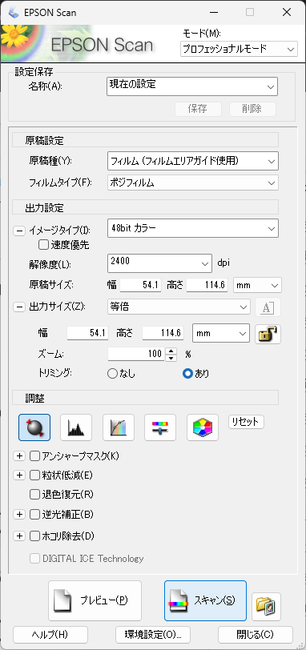
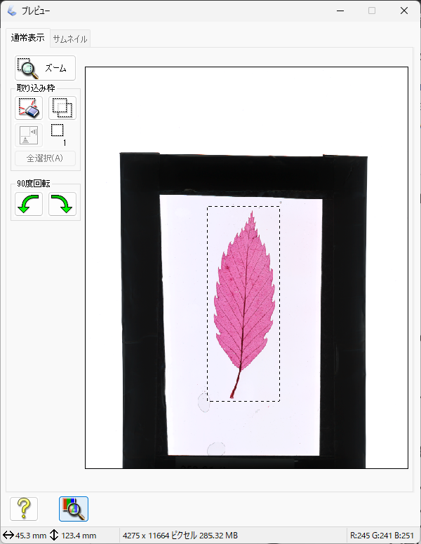
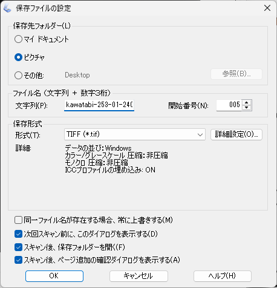

## 目的と今回の方針

透明化・染色済みの葉脈標本を EPSON GT-X980 で透過スキャンし、葉全体の形状および major veins（1〜3次脈）の測定用原画像を保存する。
まず全標本の全葉画像を取得する。minor veins（4次以上）の局所撮影は、余力があれば追加する。

2026年11月20日の試行では、同じ標本を2400 dpiと3200 dpiで取得した。
同一部分を同じ表示倍率で目視比較した範囲では、3200 dpiによる主要な葉脈の判別の改善は小さかったため、全葉取得の標準を2400 dpiとした。
これは1標本での目視確認であり、解像度間で測定値が一致することを検証した結果ではない。各標本で3次脈まで追えることを確認する。

## 全葉スキャンの標準設定

| 項目 | 設定 |
|---|---|
| スキャナー | EPSON GT-X980 |
| ソフトウェア | EPSON Scan |
| モード | プロフェッショナルモード |
| 読み取り方式 | 透過原稿 |
| 原稿種 | フィルム（フィルムエリアガイド使用） |
| フィルムタイプ | ポジフィルム |
| イメージタイプ | 48bitカラー（RGB各16bit） |
| 解像度 | **2400 dpi** |
| 出力サイズ | 等倍、ズーム100% |
| 保存形式 | **通常のTIFF（*.tif）**、1標本につき1ファイル |
| TIFFのデータの並び | Windows |
| TIFFのカラー／グレースケール圧縮 | 非圧縮 |
| ICCプロファイルの埋め込み | オン |

ポジフィルムは、透過原稿をネガ反転せずに取り込むための選択である。
Multi-TIFFは複数ページをまとめる形式、PRINT Image Matching II（TIFF）は印刷向け情報を持つ形式であり、今回の原画像保存には通常のTIFFを使う。
TIFFのモノクロ圧縮設定は、今回のカラー取り込みには適用されない。

ICCプロファイルはRGB値の色としての解釈を伝える情報であり、埋め込み自体は葉脈の強調処理ではない。
ただし、スキャン時の色管理設定や、後処理ソフトによるプロファイル変換は画素値に関係するため、解析時は色空間の変換の有無をそろえる。

### スキャナー側の補正

次の補正はオフにする。

- アンシャープマスク
- モアレ除去
- 退色復元
- 逆光補正
- ホコリ除去
- DIGITAL ICE Technology
- 粒状低減（選択可能な場合）

露出、ヒストグラム、濃度補正、色管理などの条件も記録し、比較する標本間でできるだけそろえる。
上記のチェックを外すだけで、自動露出や色管理まで無効になるとは限らない。
今回の試行での露出・色管理の詳細値は未記録なので、以後の取得前に設定を確認し、画面の保存などで残す。

## 取得手順と確認

1. 原稿台と標本の外側の汚れを確認する。汚れていたらエタノールで拭き取る。
2. 透過スキャン用に蓋の白い原稿マットを外す。
3. 標本を平らに置き、葉身・葉先・葉柄の必要部分が読み取り可能な範囲に収まるようにする。端のほうに置くと
4. 以下の画面例に沿って、設定確認、プレビュー、範囲指定、保存設定の確認を行い、本スキャンする。
5. 完了後、保存画像を開き、葉先や葉縁の欠け、ぼけ、白飛び・黒つぶれ、3次脈の視認性を確認する。プレビューだけで判定しない。
6. 標本IDとファイル名の対応を記録する。気泡、損傷、折れ、濃い染色斑、異物なども記録する。

### 1. 設定を確認してプレビューする

プレビュー前の画面で、原稿種、ポジフィルム、48bitカラー、2400 dpi、等倍・100%、画像補正オフを確認し、［プレビュー］を押す。
原稿サイズや出力サイズの幅・高さは取り込み枠に応じて変わるので、画面例の数値に合わせる必要はない。

{#fig-scan-settings width=382px}

### 2. プレビュー画像で範囲を指定してスキャンを押す

［通常表示］のプレビュー画像上で、葉身・葉先・葉柄の必要部分を欠かさず、なるべく標本だけが入るように手動で矩形の取り込み枠を指定する。
少しの余白を残し、周囲の大きな枠や不要な背景はできるだけ除く。
取り込み範囲が大きいほど画素数が増え、スキャン時間と保存容量が大きくなる。

範囲を確認したら、EPSON Scanの設定画面にある［スキャン］を押す。

{#fig-scan-preview width=600px}

### 3. 保存ファイルの設定を確認して本スキャンする

［保存ファイルの設定］画面で、保存先、標本IDを含むファイル名、開始番号を確認する。
保存形式が［TIFF（*.tif）］であり、詳細欄が「データの並び：Windows」「カラー／グレースケール圧縮：非圧縮」「ICCプロファイルの埋め込み：ON」となっていることを確認する。
変更が必要な場合は［詳細設定］で調整する。

［OK］を押すと本スキャンが始まる。2400 dpi・48bitカラーでの取り込みは時間がかかるため、完了を待つ。
画像はこの画面で指定した保存先に出力される。画面例では［ピクチャ］だが、実際の標本画像の保存先はデータ管理用フォルダーに合わせて選ぶ。

{#fig-scan-save width=458px}

### 画像とスケールの確認

スキャナーが設定どおりの画素数で出力したかを確認する際には、2400 dpiは約0.01058 mm/画素（10.58 µm/画素）に相当する。
この値はサンプリング間隔であり、実際の光学的な分解能を保証しない。
必要に応じて既知長のスケールで実寸との対応も確認する。

原画像を残し、色チャンネル選択、コントラスト調整、二値化などは別ファイルまたは解析処理として行う。
JPEGからTIFFへの変換では、JPEG圧縮で失われた情報は戻らない。JPEGで取得した試行画像とTIFF原画像は区別する。

このページの説明用スクリーンショットは、リポジトリ内の `notebooks/images/scanning_protocol/` にPNG形式で保存する。
ページから相対パスで参照し、文書と一緒に管理する。測定対象となる標本のTIFF原画像とは保存先を分ける。

## ファイル名と取得記録

例として、全葉画像は `標本ID_whole_2400dpi.tif`、再取得時は `標本ID_whole_2400dpi_r02.tif` とする。
同名ファイルの自動上書きは避け、既存ID体系があればそれを優先する。

取得記録には少なくとも、標本ID、ファイル名、取得日、解像度、色深度、透過／反射、露出・色管理設定、取得上の問題を残す。
スキャン条件を変えた場合は、変更理由も記録する。

## 解析時の葉身面積

全葉画像から葉脈長を測るときは、同じ標本画像の葉身面積を分母に使う。
`Apply Otsu` で葉身候補を表示し、葉柄・異物を除き、輪郭や穴の扱いを手修正する。
`Confirm Leaf & Extract Veins` で確定すると、面積を計算し、その領域内で葉脈を抽出する。
標本化前の面積は別の記録として保持し、標本の葉脈長と無条件に組み合わせない。
標本面積を使っても収縮を補正した生葉状態のVLAになるわけではない。
局所ROIでは対応する局所面積を使い、全葉面積とは区別する。

## minor veinsの追加撮影案（未確定）

以下は全葉取得後に検討する追加案であり、今回の全葉の標準手順には含めない。

- 同じ標本の葉身を長さ方向に上・中・下の3区画に分け、各区画から1領域を選ぶ。
- 一次脈を避け、主脈と葉縁の間を対象とする。位置を全葉画像に記録する。
- 局所を**4800 dpiで再スキャン**する。2400 dpi画像を切り出して拡大する操作とは異なる。
- 撮影範囲は例えば5 × 5 mm、測定範囲はその中の2 × 3 mm（6 mm²）を試す。これは今回の試案であり、原法で固定された寸法ではない。
- 二次脈または三次脈が撮影範囲の端に入ると、葉脈次数を判断する手掛かりになる。二次脈の長さをminorに含めない。
- minor VLAの分母を測定領域全体とするか、二次脈などの占有面積を除くかを事前に定め、標本間で統一する。

Scoffoni et al.（2011）は、上・中・下の中央付近から各1領域、計3領域（各1.5または6 mm²）を顕微鏡の5×または10×対物レンズで撮影し、細脈の測定値を平均している。
公開プロトコルでも各1.5 mm²以上の3矩形領域を用い、次数判定のため画像上辺に二次脈または三次脈を含めることを勧めている。
この方法は顕微鏡画像を前提とし、スキャン画像の解像力不足を指摘している。
したがって、4800 dpiスキャンをminorの定量に採用するには、最細脈や自由末端の見落としがないか、可能なら同一領域の顕微鏡画像と比較して検証する。

GT-X980のフィルムエリアガイド使用時の公称光学解像度は4800 dpiであり、6400 dpiはフィルムホルダー使用時の仕様である。
今回の設置方法で6400 dpiを選択できても、追加の構造情報が得られるとは限らない。

## Methods用文案

以下は採用した全葉設定に対応する文案である。実際の取得記録と照合し、未実施の処理や確認を実施済みとして記述しない。
透明化・染色・封入方法、標本数、サンプリング設計、葉脈次数の判定と計測方法は別途追記する。

> 透明化・染色した葉脈標本の全葉画像を、フラットベッドスキャナー（EPSON GT-X980）およびEPSON Scanを用いて透過光で取得した。プロフェッショナルモードで原稿種を「フィルム（フィルムエリアガイド使用）」、フィルムタイプを「ポジフィルム」とし、2400 dpi、48bitカラー、等倍で取り込んだ。アンシャープマスク、モアレ除去、退色復元、逆光補正、ホコリ除去およびDIGITAL ICEは使用せず、画像をICCプロファイル付きの非圧縮TIFFとして保存した。Major veinsを1〜3次脈、minor veinsを4次以上と定義し、全葉画像をmajor veinsの測定に用いた。

minorの局所撮影は現段階のMethods文案に含めない。

## 根拠と参考資料

既存研究のdpi設定は装置・標本条件を含む個別の例であり、それだけで今回の解像力を保証するものではない。

| 資料 | 関連する方法・仕様 |
|---|---|
| [Sack et al.（2012）, Nature Communications](https://www.nature.com/articles/ncomms1835) | 全葉を600〜1200 dpiで取得し、1〜3次脈の形質を測定。minorは顕微鏡画像を使用。 |
| [Quercus ilexの研究（2014）, Annals of Botany](https://pmc.ncbi.nlm.nih.gov/articles/PMC4111378/) | 透明化・染色葉を1200 dpiで取得し、1〜3次脈の長さからmajor vein densityを算出。 |
| [Scoffoni et al.（2011）, Plant Physiology](https://sites.lifesci.ucla.edu/eeb-sacklab/wp-content/uploads/sites/71/2016/03/ScoffoniRawlsMcKownCochardSack_2011_PlantPhys.pdf) | majorを1〜3次、minorを4次以上とする定義、minorの3領域測定。 |
| [Scoffoni・Sack, Quantifying leaf vein traits](https://prometheusprotocols.net/structure/anatomy-and-microscopy/anatomical-image-analysis/quantifying-leaf-vein-traits/) | 撮影位置、次数判定、占有面積の扱い。別ページの[参考プロトコル](prometheus_leaf_vein_protocol.qmd)も参照。 |
| [GT-X980ユーザーズガイド：フィルムのスキャン](https://download4.epson.biz/sec_pubs/epson_gt-x980/useg/ja/html/sb_1.htm) | 原稿種、フィルムタイプ、色深度などの設定。 |
| [GT-X980製品情報](https://www.epson.jp/products/scanner/gtx980/) | フィルムホルダー使用時6400 dpi、反射原稿／フィルムエリアガイド使用時4800 dpi。 |
| [International Color Consortium：プロファイル](https://www.color.org/profile/) | 埋め込みプロファイルによる色データの解釈。 |

資料参照日：2026年11月20日。
