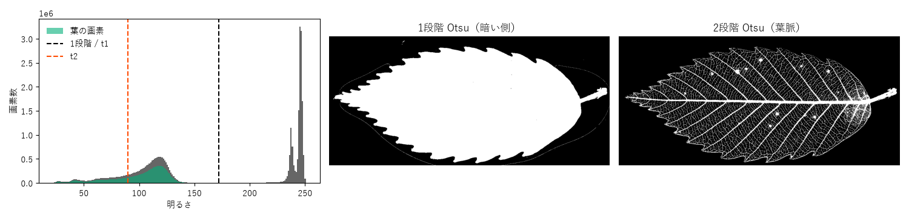
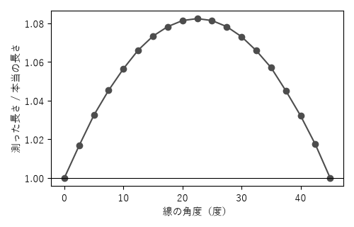
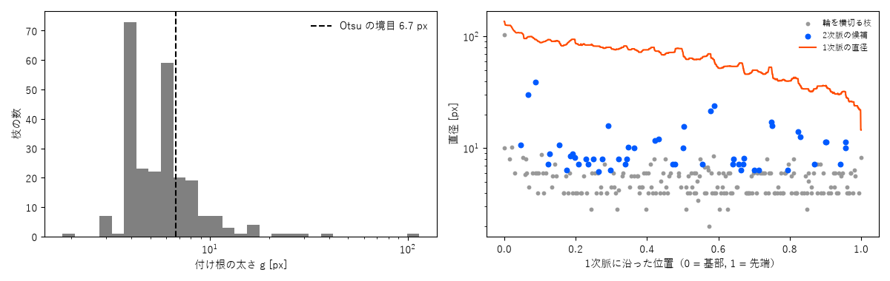
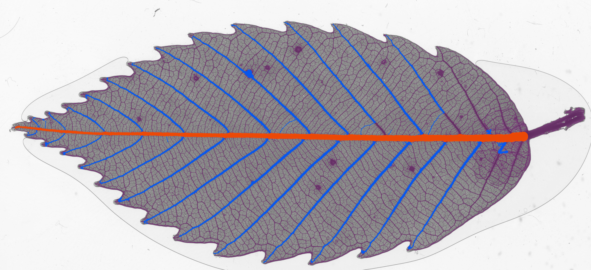
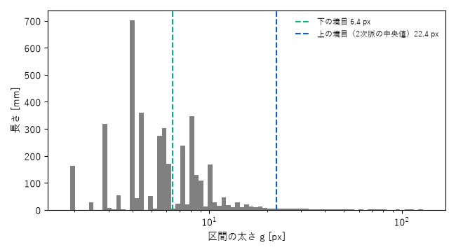
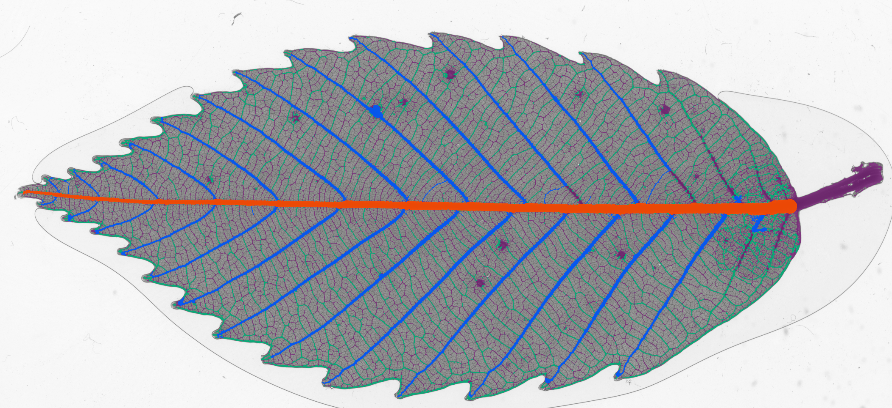
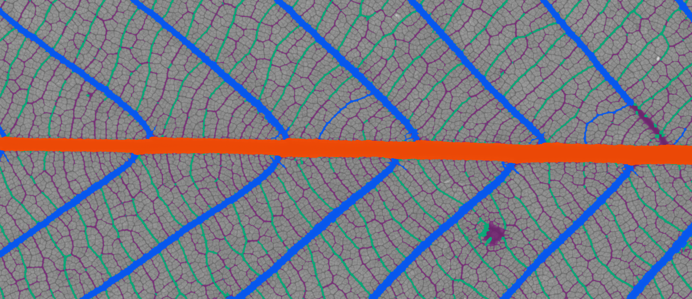

## 目的

このノートは、napari プラグインの中で動いている計算を、数式と実データでの振る舞いから説明します。
対象は次の4つです。

1. 2段階 Otsu による葉脈 mask の作成（`threshold.py`）
2. 骨格と直径（太さ）の求め方（`skeleton.py`、`auto_order.py`）
3. 1次脈・2次脈の自動振り分け（`auto_order.py`）
4. 長さと VLA の計算（`order.py`）

実データは、3200 dpi でスキャンしたコナラ（*Quercus serrata*）の葉脈標本1枚です。
2次脈がまっすぐ鋸歯に入る型（craspedodromous）の葉です。

## 記号

このノートでは、次の記号を使います。

| 記号 | 意味 |
|---|---|
| $I(p)$ | 画素 $p$ の明るさ（グレースケール、Gaussian で平滑化済み。8 bit の画像では 0〜255） |
| $M$ | 葉脈 mask（葉脈 = 1 の画素の集合） |
| $S$ | $M$ の骨格（中心線の画素の集合） |
| $d(p)$ | 画素 $p$ での葉脈の直径（px） |
| $G=(V,E)$ | 骨格の画素を頂点、隣り合う画素どうしを辺とするグラフ |
| $\ell(u,v)$ | 辺の長さ（縦横の隣は 1、斜めの隣は $\sqrt2$） |
| $s$ | 校正値（mm/px）。3200 dpi では $s = 25.4/3200 = 0.0079375$ |

## 準備

### コード

画像の場所、ROI、2回のクリックの位置をここで決めます。クリック位置は napari で付けるのと同じ「切り抜いた画像の座標」（行, 列）です。

```{python}
import time
from pathlib import Path

import matplotlib.pyplot as plt
import numpy as np
from scipy import ndimage
from skimage import io
from skimage.morphology import remove_small_holes, remove_small_objects

from leaf_vein_workflow.auto_order import auto_assign_orders
from leaf_vein_workflow.order import measure_order_labels
from leaf_vein_workflow.threshold import (
    estimate_vein_threshold,
    otsu_threshold,
    smooth_image,
    threshold_image,
    to_grayscale,
)

SCAN = Path(
    r"C:\Users\Konrai\Dropbox\GitHub\phd-thesis\assets"
    r"\20260719_konara_tomakomai_244_01_3200dpi_kleaf_011.jpg"
)
plt.rcParams["font.family"] = ["Yu Gothic", "Meiryo", "sans-serif"]  # 図の日本語
FIG = Path("figures/auto_order")
FIG.mkdir(parents=True, exist_ok=True)
ROI = (slice(230, 4088), slice(42, 8452))  # napari の ROI と同じ範囲
MM_PER_PX = 25.4 / 3200
BASE, APEX = (1956, 7447), (1844, 195)  # 葉の基部と1次脈の先端（切り抜き座標）

gray = to_grayscale(io.imread(SCAN))
crop = gray[ROI]
smooth = smooth_image(crop, 1.0)
print("ROI の大きさ:", crop.shape)
```

## 1. 2段階 Otsu による葉脈 mask

スキャン画像に対してROIを切り出すと、背景と葉でまず分かれます。
このため一度の二値化では、葉内部の葉脈だけはうまく分離できません。
そこで、葉と背景の二値化をした後、葉の中で葉脈と葉身を分ける二段階の Otsu threshold を使います。

### 目的

葉脈の画素と、それ以外（葉身・背景の紙）を分ける閾値を決めます。
あわせて、閾値のどちら側が葉脈かも決めます。

### 方法

**Otsu の方法**（Otsu's method）は、明るさのヒストグラムを2つの組に分ける閾値 $t$ を選ぶ方法です。
閾値で分けた2組の平均がなるべく離れ、しかも両方の組に十分な画素があるような $t$ を選びます。
式では、次の**クラス間分散**（between-class variance）を最大にする $t$ です。

$$
t^{*} = \arg\max_t \; \omega_0(t)\,\omega_1(t)\,\bigl(\mu_0(t) - \mu_1(t)\bigr)^2
$$

ここで $\omega_0, \omega_1$ は暗い組・明るい組の画素の割合、$\mu_0, \mu_1$ はそれぞれの平均の明るさです。
人が閾値を選ばずに済むので、再現性が上がります。

問題は、葉全体を囲む ROI では画像に**3つ**の組があることです。
暗い葉脈、中間の葉身、明るい紙です。Otsu は2組にしか分けないので、いちばん大きな差である「葉 と 紙」を分けてしまいます。
そこで、2回に分けて Otsu を使います。

1. **1回目**：画像全体で Otsu をかけ、$t_1$ で「葉」と「背景」に分ける。背景は、ROI の縁の画素に多い側とする。
2. **背景かどうかの確認**：背景とした組のうち、ROI の縁につながっている連結成分の画素が 80% 以上なら、本当の背景（紙）とみなす。葉身の内側だけの ROI では、明るい側（葉身）は葉脈に囲まれた小さな網目（areole）に分かれていて縁に届かないので、この条件で区別できる。
3. **2回目**：葉の画素だけで Otsu をかけ、$t_2$ で葉脈と葉身を分ける。
4. **どちらが葉脈か**：葉の中で**少ない側**を葉脈とする。暗い側が少なければ `Invert`（暗い画素が葉脈）にする。

最後に、葉脈の側の画素のうち葉の中にあるものを mask にします。式で書くと、暗い側が葉脈の場合は次のとおりです。

$$
M = \{\,p \mid I(p) \le t_2\,\} \cap \text{葉}
$$

### コード

1段階と2段階の Otsu を同じ画像で比べます。

```{python}
t_one = otsu_threshold(smooth)
one_step_dark = smooth <= t_one

est = estimate_vein_threshold(smooth, exclude_background=True)
leaf = est.leaf_mask
vein_raw = threshold_image(smooth, est.threshold, invert=est.invert) & leaf
print(f"1段階: t = {t_one:.3f}, 暗い側 = ROI の {one_step_dark.mean():.1%}")
print(f"2段階: t1 = {est.leaf_threshold:.3f}, 葉 = ROI の {leaf.mean():.1%}")
print(f"       t2 = {est.threshold:.3f}, 葉脈の側 = {est.vein_side}, "
      f"葉脈 = 葉の {est.vein_fraction:.1%}")

inner = smooth_image(gray[1400:2900, 2500:5500], 1.0)
est_inner = estimate_vein_threshold(inner, exclude_background=True)
print(f"葉身の内側だけの ROI: 背景あり = {est_inner.leaf_mask is not None}, "
      f"葉脈の側 = {est_inner.vein_side}, 葉脈 = {est_inner.vein_fraction:.1%}")

fig, ax = plt.subplots(1, 3, figsize=(15, 3.6))
ax[0].hist(smooth.ravel(), bins=200, color="0.4")
ax[0].hist(smooth[leaf].ravel(), bins=200, color="#03af7a", alpha=0.6, label="葉の画素")
for value, name, color in ((t_one, "1段階 / t1", "k"), (est.threshold, "t2", "#ff4b00")):
    ax[0].axvline(value, color=color, ls="--", label=name)
ax[0].set_xlabel("明るさ"); ax[0].set_ylabel("画素数"); ax[0].legend(frameon=False)
ax[1].imshow(one_step_dark[::8, ::8], cmap="gray"); ax[1].set_title("1段階 Otsu（暗い側）")
ax[2].imshow(vein_raw[::8, ::8], cmap="gray"); ax[2].set_title("2段階 Otsu（葉脈）")
for a in ax[1:]:
    a.set_axis_off()
fig.tight_layout(); fig.savefig(FIG / "otsu_two_step.png", dpi=100)
```

### 結果

実行したときの出力です（明るさは 0〜255）。

- 1段階の Otsu：$t = 172.0$。暗い側は ROI の 53.8%。
- 2段階の Otsu：
  - 1回目 $t_1 = 172.0$。葉は ROI の 53.8%。
  - 2回目 $t_2 = 89.7$。少ない側は暗い側で、葉脈は葉の 25.2%。
- 葉身の内側だけの ROI（約 1,500 × 3,000 px）：背景は見つからず1段階に戻り、暗い側の 21.8% が葉脈になりました。



### 結果の読み方

ヒストグラムには3つの山があります。明るさ 245 付近の高い山が紙、120 付近が葉身、それより暗い長い裾が葉脈です。

1段階の Otsu の閾値（172）は、紙と葉の間の谷に入ります。暗い側（53.8%）を mask にすると、中央の図のように**葉身全体**が選ばれます。以前、Export で葉身全体が mask になっていたのはこのためです。

2段階目では、葉の画素だけ（緑のヒストグラム）で閾値を選び直します。$t_2 = 89.7$ は、葉身の山の暗い側の裾に入り、右の図のように葉脈の網目だけが残ります。葉脈が葉の 25.2% という値は、葉身の内側だけを ROI にしたとき（21.8%）とも近く、同じ組を選べていると考えられます。

### 注意点

- 「葉脈は葉の中で少ない側」という前提は、葉脈密度が高い葉や、mask が太り気味のときに崩れることがあります。napari では状態表示に葉脈の割合を出し、45% を超えると注意を出します。
- 背景の判定（縁につながる割合 80%）は経験的な値です。葉が ROI の縁に大きく接していると、紙が縁で分断されて判定が変わる可能性があります。
- 透過光で撮った標本では葉脈が暗く写ります。反射光の生葉では逆になることがありますが、「少ない側」で決めているので向きの指定は不要です。

## 2. 骨格と直径

### 目的

葉脈の長さと太さを測るために、mask から中心線（骨格）と各点の直径を求めます。

### 方法

**骨格化**（skeletonization）は、領域のつながり方を保ったまま外側から1画素ずつ削り、幅1画素の中心線にする処理です。
実装には、Pythonで scikit-image の `skeletonize` 関数を使用します。

**直径**は、**ユークリッド距離変換**（Euclidean distance transform, EDT）で求めます。
EDT は、mask の中の各画素に「いちばん近い背景画素までの距離」を入れた画像です。
中心線の上では、この距離が葉脈の半径にあたるので、直径は次の式で求めます。

$$
d(p) = 2\,\mathrm{EDT}_M(p)
$$

以前は `medial_axis` の距離を使っていましたが、定義は同じで EDT の方が速いので置き換えました。

骨格は**グラフ**として扱います。
骨格の画素を頂点とし、8近傍で隣り合う画素どうしを辺で結びます。
実装には、Python で skan の `Skeleton` 関数を使用します。

辺の長さ $\ell$ は、縦横の隣なら 1、斜めの隣なら $\sqrt2$ です。

### コード

mask の後片付けは、napari の `Clean Mask` の推奨値（100 px 以下の小片を除去、50 px 以下の穴を埋める）と同じにしています。

```{python}
vein = remove_small_holes(remove_small_objects(vein_raw, 100), 50)
from leaf_vein_workflow.auto_order import _VeinGraph  # 説明のため内部の関数を使う
from leaf_vein_workflow.skeleton import drop_isolated_pixels
from skimage.morphology import skeletonize

skeleton = drop_isolated_pixels(skeletonize(vein).astype(np.uint8)).astype(bool)
diameter = 2.0 * ndimage.distance_transform_edt(vein)
graph = _VeinGraph(skeleton, diameter)
print(f"mask = ROI の {vein.mean():.1%}, 骨格 = {skeleton.sum():,} px, 頂点 = {graph.n:,}")
values, counts = np.unique(np.round(graph.diameter[graph.diameter < 10], 1), return_counts=True)
print("骨格上の直径（10 px 未満）に現れる値:", values[:12].tolist())
```

### 結果

- mask（`Clean Mask` の推奨値で後片付けした後）は ROI の 13.3%。
- 骨格は 486,213 px で、そのまま 486,213 個の頂点になりました。
- 骨格上の直径に現れる値（10 px 未満）は 2.0, 2.8, 4.0, 4.5, 5.7, 6.0, 6.3, 7.2, 8.0, … と飛び飛びでした。

### 結果の読み方

直径が飛び飛びの値になるのは、EDT が画素の中心どうしの距離（$\sqrt{a^2+b^2}$ の形の値）しか取らないためです。たとえば 4.0 と 4.5 の間の値は出ません。

3200 dpi では 1 px が約 7.9 µm なので、4 px の脈は約 32 µm、6 px は約 48 µm です。細い脈の太さは、この刻みの粗さの範囲でしか区別できません。

### 注意点

- 直径は画素の格子の上で測るので、細い脈ほど相対誤差が大きくなります。3200 dpi で 4 px（約 32 µm）の脈では、1 px の違いが 25% にあたります。1200 dpi では 2次脈でも数 px になり、太さの比較が難しくなります。
- 分岐点では、2本の脈が重なって EDT が大きくなります（分岐点の太り）。このため、太さは分岐点から離れた所で測ります（4.2 節）。

## 3. 長さと VLA

### 目的

次数ごとの葉脈の総延長 $L_k$ と、**VLA**（vein length per area、葉面積あたりの葉脈長）を求めます。

### 方法

次数 $k$ のラベルが付いた領域を骨格化し、その骨格を枝（分岐点や端点で区切った区間）に分けます。それぞれの枝の長さは、隣り合う画素の間の距離の合計です。

$$
L_k = s \sum_{\text{枝 } b} \;\sum_{(u,v) \in b} \ell(u,v) \quad [\text{mm}],
\qquad
\mathrm{VLA}_k = \frac{L_k}{A} \quad [\text{mm mm}^{-2}]
$$

$A$ は標本にする前の生葉のスキャンで測った葉面積（mm²）です。1次+2次や major（1〜3次）の行は、次数ごとの $L_k$ の**和**にしています。次数をまとめた領域を骨格化し直すと、次数の境目で骨格が近道をして、major が primary より短くなることがあったためです。

### コード

斜めの線を引いて、この長さの測り方の誤差を確かめます。

```{python}
from skimage.draw import line
from skan import Skeleton
from skan.csr import summarize

angles = np.linspace(0, 45, 19)
ratios = []
for angle in angles:
    length = 400
    r1 = int(round(10 + length * np.sin(np.radians(angle))))
    c1 = int(round(10 + length * np.cos(np.radians(angle))))
    img = np.zeros((450, 450), np.uint8)
    rr, cc = line(10, 10, r1, c1)
    img[rr, cc] = 1
    measured = summarize(Skeleton(img), separator="-")["branch-distance"].sum()
    ratios.append(measured / np.hypot(r1 - 10, c1 - 10))
ratios = np.array(ratios)
print("測った長さ / 本当の長さ: 最小", ratios.min().round(3), "最大", ratios.max().round(3),
      "（最大は", angles[ratios.argmax()], "度）")
fig, ax = plt.subplots(figsize=(5, 3.2))
ax.plot(angles, ratios, "o-", c="0.3")
ax.axhline(1, c="k", lw=0.8)
ax.set_xlabel("線の角度（度）"); ax.set_ylabel("測った長さ / 本当の長さ")
fig.tight_layout(); fig.savefig(FIG / "chain_length_bias.png", dpi=100)
```

### 結果

測った長さ / 本当の長さは、0° と 45° で 1.000、最大は 22.5° のとき 1.082 でした。



### 結果の読み方

画素の鎖で長さを測ると、線の向きによって最大で約 8% 長く出ます。0°（縦横）と 45°（斜め）では1歩の長さ（1 と $\sqrt2$）が線の向きと一致するので正確です。その中間の角度では、縦横と斜めの歩みを組み合わせたジグザグになり、まっすぐな線より長くなります。

この偏りは向きだけで決まり、葉脈の太さや次数には依存しません。

### 注意点

- 葉脈は曲がりながら走るので、実際の偏りは角度ごとの偏りの平均になります。種や次数の比較では同じ測り方なので偏りはほぼ打ち消し合いますが、ほかの方法で測った文献値と絶対値を比べるときは注意が必要です。
- 骨格には、縁のでこぼこから出る短いひげ（spur）が含まれ、長さを少し過大にします。以前の試算では、10 px 以下のひげが総延長の約 10% でした。ひげの除去はまだ入れていません。

## 4. 1次脈・2次脈の自動振り分け

### 全体の考え方

次数の決め方は Manual of Leaf Architecture（Ellis et al., 2009）に従います。要点は次の4つです。

- 次数は**太さ**（gauge）と**走り方**（course）の両方で決める。
- 次数は、その脈が**最も太い所（付け根に近い所）**で判断する。
- 親と**ほぼ同じ太さ**で分かれる脈は、親と同じ次数。
- 3次脈は、1次脈・2次脈どうしを**つなぐ**脈で、網目を作る。

ユーザーが与えるのは、葉の基部と1次脈の先端の2点だけです。

### 4.1 1次脈：太い所を通る最短経路

#### 方法

骨格のグラフの各辺に、次のコストを付けます。

$$
w(u,v) = \frac{\ell(u,v)}{\max\!\Bigl(1,\ \tfrac{d(u)+d(v)}{2}\Bigr)^{2}}
$$

基部から先端まで、コストの合計が最小になる経路を **Dijkstra 法**（重み付きグラフの最短経路を求める標準的な方法）で求め、1次脈とします。

コストが長さを直径の2乗で割った形なので、太い脈の上は「安く」、細い脈の上は「高く」なります。たとえば直径 80 px の主脈を 1 px 進むコストは $1/6400$ で、直径 5 px の細い脈を 1 px 進むコスト $1/25$ の 256 分の1です。そのため経路は、多少遠回りでも主脈から外れません。2乗という指数は経験的に選んだ値で、大きくするほど太い脈を強く好みます。

クリックした点は、近く（半径 0.6 mm）の骨格のうち、そこでの最大直径の半分以上の太さがある画素のうち最も近いものに合わせます。「最も太い画素」に合わせると、先端のクリックが上流の分岐点（分岐点の太りで太く見える）へ飛んでしまうためです。

### 4.2 1次脈のまわりの座標

2次脈を探す前に、骨格の各頂点について、1次脈との位置関係を3つの量で表します。

- **縁からの距離** $o(v)$：1次脈の中心線までの距離から、そこでの1次脈の半径を引いた値。1次脈の外側の縁から何 px 離れているかを表します。1次脈の半径には、直径を経路に沿って中央値フィルタ（窓 101 点）でならした値の半分を使います。分岐点の太りの影響を避けるためです。
- **位置**：最も近い1次脈の点が、基部から何番目か。
- **側**：1次脈の進む向き $\mathbf t$ と、1次脈から頂点への向き $\mathbf r$ の外積の符号 $\operatorname{sign}(t_r r_c - t_c r_r)$。画像の上下ではなくこの符号で左右を決めるので、葉の向きに左右されません。

### 4.3 2次脈の候補：付け根の太さ

#### 方法

1次脈の縁のすぐ外側に**輪**を置きます。

$$
R = \{\, v \mid 0.05\ \text{mm} < o(v)\, s \le 0.37\ \text{mm} \,\}
$$

輪の中の骨格を連結成分に分けると、1つの成分が「1次脈から出ていく1本の枝」になります。枝の**付け根の太さ** $g$ は、その成分の直径の中央値です。輪を縁から少し離しているのは、分岐点の太りを避けるためです。Ellis の「次数は付け根の最も太い所で判断する」に対応します。

枝 $i$ を2次脈の候補とする条件は、次のとおりです。

$$
g_i \;\ge\; \max\!\Bigl(g_{\min},\; 0.7 \max_{j \in N(i)} g_j\Bigr)
$$

$N(i)$ は、同じ側で1次脈に沿って ±1.75 mm 以内にある枝の集合、$g_{\min}$ は 0.048 mm（3200 dpi で 6 px）です。つまり「**近くで最も太い枝の 7 割以上**」なら候補にします。1次脈の両端（直径の2倍以内）から出る枝は、葉柄や先端なので除きます。

固定の境目を使わない理由は、次の結果で示します。

#### コード

```{python}
from leaf_vein_workflow.auto_order import AutoOrderParams, _PrimaryGeometry, _secondary_origins

px = lambda mm: mm / MM_PER_PX  # noqa: E731
params = AutoOrderParams()
primary = graph.cheapest_path(graph.snap(BASE, px(0.6)), graph.snap(APEX, px(0.6)))
geometry = _PrimaryGeometry(graph, primary, skeleton.shape)
print(f"1次脈: {graph.length(primary):.0f} px = {graph.length(primary) * MM_PER_PX:.1f} mm")
pd = geometry.primary_diameter
print(f"1次脈の直径: 基部 {pd[:200].mean():.0f} px, 中央 {pd[len(pd)//2]:.0f} px, "
      f"先端 {pd[-200:].mean():.0f} px")

# 輪を横切るすべての枝（候補を選ぶ前）
in_ring = (geometry.node_offset > px(params.ring_inner_mm)) & (
    geometry.node_offset <= px(params.ring_outer_mm))
ring_img = np.zeros(skeleton.shape, bool)
ring_img[graph.rows[in_ring], graph.cols[in_ring]] = True
comp, n = ndimage.label(ring_img, structure=np.ones((3, 3)))
node_comp = comp[graph.rows, graph.cols]
crossings = []
for k in range(1, n + 1):
    nodes = np.flatnonzero(node_comp == k)
    if nodes.size >= 0.6 * (px(params.ring_outer_mm) - px(params.ring_inner_mm)):
        crossings.append((np.median(graph.diameter[nodes]),
                          np.median(geometry.node_position[nodes]) / len(primary)))
crossings = np.array(crossings)
chosen = _secondary_origins(graph, geometry, params, px)
from skimage.filters import threshold_otsu
otsu_split = np.exp(threshold_otsu(np.log(crossings[:, 0])))
print(f"輪を横切る枝: {len(crossings)} 本, 2次脈の候補: {len(chosen)} 本")
print(f"太さに Otsu をかけた境目: {otsu_split:.1f} px, 10 px 以上: {(crossings[:, 0] >= 10).sum()} 本")

fig, ax = plt.subplots(1, 2, figsize=(12, 3.8))
bins = np.logspace(np.log10(1.8), np.log10(crossings[:, 0].max() * 1.1), 30)
ax[0].hist(crossings[:, 0], bins=bins, color="0.5")
ax[0].axvline(otsu_split, c="k", ls="--", label=f"Otsu の境目 {otsu_split:.1f} px")
ax[0].set_xscale("log"); ax[0].set_xlabel("付け根の太さ g [px]"); ax[0].set_ylabel("枝の数")
ax[0].legend(frameon=False)
chosen_pos = np.array([o.position / len(primary) for o in chosen])
chosen_g = np.array([o.gauge for o in chosen])
ax[1].scatter(crossings[:, 1], crossings[:, 0], s=10, c="0.6", label="輪を横切る枝")
ax[1].scatter(chosen_pos, chosen_g, s=22, c="#005aff", label="2次脈の候補")
ax[1].plot(np.linspace(0, 1, len(pd)), pd, c="#ff4b00", label="1次脈の直径")
ax[1].set_yscale("log"); ax[1].set_xlabel("1次脈に沿った位置（0 = 基部, 1 = 先端）")
ax[1].set_ylabel("直径 [px]"); ax[1].legend(frameon=False, fontsize=8)
fig.tight_layout(); fig.savefig(FIG / "secondary_gauge.png", dpi=100)
```

#### 結果

- 1次脈の経路は 7,435 px（59.0 mm）でした。直径は基部 124 px、中央 73 px、先端 24 px で、先端に向かって細くなっています。
- 1次脈の縁の外の輪を横切る枝は 252 本ありました。
- 付け根の太さに Otsu をかけると、境目は 6.7 px になりました。
- 10 px 以上の枝は 24 本で、これは目で数えた2次脈の本数（両側で約 25 本）とほぼ一致します。
- 「近くで最も太い枝の 7 割以上」の条件では、51 本が2次脈の候補になりました。



#### 結果の読み方

左の図のように、付け根の太さの分布は「二つの山」ではなく、4〜6 px の大きな山と、10 px 以上の長い裾の形でした。4〜6 px の山は、1次脈から直接出る3次脈や、さらに細い脈です。10 px 以上の裾が2次脈です。

Otsu は二つの山を仮定する方法なので、この分布では 6.7 px という、3次脈の山の中の誤った所で切ってしまいます。

右の図では、2次脈の候補（青）の太さが、1次脈と同じように先端に向かって下がっています。基部近くの2次脈は 20〜40 px ありますが、先端近くでは 7〜12 px です。そのため、固定の境目を一つ決めると、基部の3次脈と先端の2次脈を取り違えます。

「近くで最も太い枝との比」で選ぶと、場所ごとの太さの違いが打ち消されます。代わりに候補は 51 本と多めになり、3次脈も混ざります。それを 4.5 節の走り方の条件で落とします。

### 4.4 2次脈の走り方：葉縁まで追跡し、太さが急に落ちたら切る

#### 方法

各候補について、輪の外側の端から、同じ側の**葉縁の帯**（葉の輪郭から 0.2 mm 以内）まで、4.1 節と同じコストで最短経路を求めます。1次脈の内側（$o(v) \le 2$ px）は通れないようにします。葉の輪郭には、1節の2段階 Otsu で得た「葉」の領域を、**穴を埋めてから**使います。葉身の中の明るい点が輪郭の穴として残ると、その周りも葉縁の帯とみなされ、追跡が葉の途中で止まってしまうためです（4.7 節）。

経路がそのまま葉縁まで行くとは限りません。2次脈が縁の手前でループする葉では、細い脈を通って葉縁へ向かうことがあります。そこで、経路に沿った直径の列 $d_1, d_2, \dots$ を見て、**太さが急に落ちた所**で切ります。窓の長さを $w = \max(5,\ 2g)$ として、

$$
\operatorname{median}(d_{i}, \dots, d_{i+w-1}) \;<\; 0.55 \times \operatorname{median}(d_{i-w}, \dots, d_{i-1})
$$

となる最初の $i$ で経路を切ります。2次脈は鋸歯に向かって**ゆっくり**細くなるので、隣り合う窓どうしの比ではこの条件に当たりません。細い脈へ寄り道したときだけ、太さが**急に**半分近くまで落ちます。Ellis の「ほぼ同じ太さで続く脈は同じ次数」に対応します。

切られずに葉縁の帯まで届いた経路は、帯の中を長さ 0.4 mm 以内で、最も外側の点まで延ばします。延長の長さを制限しているのは、帯が葉縁の脈（marginal vein）で葉の周り全体につながっていて、制限しないと葉縁に沿って隣の鋸歯まで進んでしまったためです。

### 4.5 3次脈の除外：太い2次脈に合流する候補

#### 方法

1次脈から直接出る3次脈（Ellis の epimedial tertiary）は、付け根の太さだけでは2次脈と区別しきれないことがあります。ただし走り方が違い、少し進むと隣の2次脈に**合流**します。そこで、次の手順で候補を絞ります。

1. 候補を付け根の太さ $g$ の大きい順に並べる。
2. 順に見て、経路のうち「すでに採用した2次脈から 3 px 以内」にある点の割合 $f$ を求める。
3. $f > 0.5$ なら、太い2次脈に合流する3次脈（または同じ2次脈が輪を2回横切ったもの）として外す。そうでなければ2次脈として採用する。

太い順に見るので、合流先の2次脈が先に採用され、合流する側の細い脈が後で外れます。

### 4.6 ラベルを mask 全体に広げる

#### 方法

ここまでで決まるのは骨格（中心線）の上の次数です。これを mask の画素に広げます。

1. 骨格の画素はすべて 4（不確定）にし、mask の各画素に**最も近い骨格画素**のラベルを付ける（EDT の最近傍の添字を使う）。
2. 1次脈・2次脈の経路の各点 $v$ から半径 $d(v)/2 + 1$ px 以内の mask の画素を、その次数の**本体**として塗る。2次脈を先に、1次脈を後に塗り、重なりは1次脈を優先する。

手順2が必要なのは、太い1次脈の中に、縁のでこぼこから出た小さな骨格の枝がたくさんあるためです。手順1だけでは、1次脈の画素の多くがその小さな枝（ラベル 4）に割り当てられ、1次脈が細いジグザグの線になりました。

napari では、この結果を**現在 4（不確定）の画素だけ**に書き込みます。手で塗った所は上書きしません。

### 4.7 実行結果

#### コード

```{python}
start = time.perf_counter()
# 3次脈の推定は 4.9 節で扱うので、ここでは 1次・2次までにする
result = auto_assign_orders(
    vein, BASE, APEX, leaf_mask=leaf, mm_per_pixel=MM_PER_PX,
    params=AutoOrderParams(assign_tertiary=False),
)
elapsed = time.perf_counter() - start
summary = result.summary()
print(f"{elapsed:.0f} 秒, 2次脈 {summary['n_secondary']} 本, "
      f"合流して外した候補 {summary['n_rejected_merging_into_thicker']} 本")

rows = measure_order_labels(result.labels, pixel_size_mm=MM_PER_PX)
for row in rows:
    if row["label_name"] in ("primary", "secondary", "uncertain", "primary_secondary"):
        print(f"{row['label_name']:18s} {row['length_mm']:8.1f} mm")

s4 = 4
base = crop[::s4, ::s4] / 255.0  # to_grayscale は元の 0〜255 のまま返す
rgb = np.stack([base] * 3, -1) * 0.85 + 0.15
for value, color, alpha in ((4, (0.6, 0, 0.6), 0.35), (2, (0, 0.35, 1), 0.9), (1, (1, 0.29, 0), 0.9)):
    m = result.labels[::s4, ::s4] == value
    rgb[m] = (1 - alpha) * rgb[m] + alpha * np.array(color)
plt.imsave(FIG / "auto_order_result.png", np.clip(rgb, 0, 1))
```

#### 結果

- 実行時間は約 60 秒でした（ノート PC、骨格の頂点 約 49 万）。
- 2次脈として採用したのは 31 本、太い2次脈に合流するとして外した候補は 20 本でした。
- ラベル領域から測った長さ（3節の方法）は次のとおりです。

| ラベル | 長さ |
|---|---|
| 1次脈 | 77.2 mm |
| 2次脈 | 386.2 mm |
| 1次+2次 | 463.4 mm |
| 不確定（手で塗る） | 3,857.0 mm |



#### 結果の読み方

図では、2次脈（青）が中央脈から鋸歯まで、両側ともほぼすべて塗られています。先端近くの小さな2次脈も取れています。1次脈から直接出て隣の2次脈に合流する3次脈は、紫（不確定）のまま残っています。

目で見て誤っている所は、次の3つです。

1. **葉の基部付近**（右端）：上側の最も基部寄りの太い2次脈が取れていません。下側にも短い誤りがあります。
2. **黒い斑点**：上側中央の黒い斑点の所で、2次脈に塊が付いています。斑点が葉脈より暗く、mask に入っているためです。
3. **葉の輪郭の穴**：最初の実行では、葉の輪郭に1節の葉の領域をそのまま使ったため、2次脈が 35 本と多く出た一方で、基部側の太い2次脈がいくつか取れませんでした。葉身の中の明るい点が輪郭の「穴」になり、その周りが葉縁の帯とみなされて、追跡が途中で止まったためです。輪郭の穴を埋めてから使うように直し、この図の結果（31 本）になりました。

1次脈の長さが 77.2 mm と、経路の長さ（59.0 mm）より 3 割ほど長く出ています。原因は次の 4.8 節で調べます。

### 4.8 塗った領域から測る長さと、たどった経路の長さのずれ

#### 目的

4.7 節で、1次脈の**ラベル領域**から測った長さ（3節の方法）が、自動でたどった1次脈の**経路**の長さより長く出ました。VLA1 に直接効くので、原因を確かめます。

#### 方法

1次脈のラベル領域を骨格化し、skan で枝に分けます。skan の枝の種類（branch type）のうち、「分岐点から端点まで」（type 1）の短い枝は、領域の縁のでこぼこから出たひげ（spur）です。その長さの合計を、経路の長さと比べます。

#### コード

```{python}
from skan import Skeleton as SkanSkeleton
from skan.csr import summarize as skan_summarize

primary_region = result.labels == 1
table = skan_summarize(SkanSkeleton(skeletonize(primary_region)), separator="-")
total = table["branch-distance"].sum()
path_px = graph.length(primary)
spur = table[(table["branch-type"] == 1) & (table["branch-distance"] < 150)]
print(f"経路の長さ          {path_px * MM_PER_PX:6.1f} mm")
print(f"領域の骨格の長さ    {total * MM_PER_PX:6.1f} mm（枝 {len(table)} 本）")
print(f"うち 150 px 未満のひげ {spur['branch-distance'].sum() * MM_PER_PX:6.1f} mm（{len(spur)} 本）")
print(f"ひげを除いた長さ    {(total - spur['branch-distance'].sum()) * MM_PER_PX:6.1f} mm")
```

#### 結果

| 測り方 | 長さ |
|---|---|
| たどった経路 | 59.0 mm |
| ラベル領域の骨格（枝 151 本） | 77.2 mm |
| うち 150 px 未満のひげ（77 本） | 17.6 mm |
| ひげを除いた骨格 | 59.6 mm |

#### 結果の読み方

ラベル領域の骨格には、77 本のひげが合わせて 17.6 mm 含まれていました。これを除くと 59.6 mm になり、たどった経路の長さ（59.0 mm）とほぼ一致します。つまり、長さのずれのほぼすべてがひげです。

ひげが多いのは、1次脈の領域が太い（直径 24〜124 px）うえに、2次脈や3次脈が付いていた所で縁がでこぼこしているためです。骨格化はそのでこぼこの一つ一つに短い枝を出します。

**これは自動振り分けだけの問題ではありません。** 手で塗ったラベルも同じ方法で測るので、太い脈ほど長さが過大になります。今の実装では、VLA1 が約 3 割過大に出ている可能性があります。2次脈の長さも、程度は小さいものの同じ影響を受けていると考えられます。

対策の候補は2つあります。

- 骨格のひげを、局所の直径より短い端の枝として除いてから長さを測る。
- 自動振り分けを使った場合は、たどった経路の長さをそのまま使う。

どちらにするかは、手で塗った正解との比較で決めるのがよいと考えています。

### 4.9 残りの脈を太さで3次脈と細い脈に分ける

#### 目的

1次脈・2次脈を決めた後、残りの脈の大部分は手で塗ることになります。
その手間を減らすため、残りの脈のうち3次脈らしいものを先に 3 にしておきます。

ただし、残りの脈を**すべて** 3 にはしません。
3200 dpi の mask には、3次脈より細い脈（4次以上の細かい網目）も入っています。
4.7 節の結果では、残りの脈 3,857 mm に対して1次+2次は 463 mm で、残りの大半は細い脈です。
すべて 3 にすると、細い脈が VLA3 と VLA_major に入ってしまいます。

#### 方法

Ellis の定義では、3次脈は「網目を作る脈のうち最も太いもの」で、2次脈より細い脈です。
そこで、太さに上と下の境目を置きます。

骨格を分岐点・端点で区切った区間 $b$ ごとに、太さ $g_b$ と長さ $\ell_b$ を求めます。
$g_b$ は区間の直径の中央値で、両端から「端の半径 + 2 px」以内の点は除きます（分岐点の太りを避けるため）。
1次脈・2次脈に半分以上重なる区間は対象にしません。

区間 $b$ を3次脈とする条件は、次のとおりです。

$$
c \;\le\; g_b \;<\; \operatorname{median}\{\, d(v) \mid v \in \text{2次脈} \,\}
$$

- **上の境目**：2次脈の骨格上の直径の中央値です。これより太い区間は3次脈ではありません。葉柄や、黒い斑点の塊がここで外れます。
- **下の境目** $c$：残りの区間の $\log g_b$ に、長さ $\ell_b$ で重みを付けた Otsu をかけて決めます（120 階級のヒストグラム）。長さで重みを付けるのは、短い区間がたくさんあっても、長さとしての割合で分けたいためです。設定ファイルの `auto_order.tertiary_min_gauge_mm` で固定もできます。
- **1次脈の両端**：最も近い1次脈の点が基部または先端そのものである区間（葉柄や先端の付近）は判定せず、不確定のままにします。

3 と判定した区間は、4.6 節の手順1で骨格から mask の画素へ広げます。
その後に2次脈・1次脈の本体を上から塗るので、1次・2次の判定は変わりません。

#### コード

既定の設定（3次脈の推定あり）で振り分け、下の境目を変えると3次脈の長さがどう変わるかも確かめます。

```{python}
result3 = auto_assign_orders(vein, BASE, APEX, leaf_mask=leaf, mm_per_pixel=MM_PER_PX)
low, high = result3.tertiary_gauge_range_px
print(f"3次脈とした太さ: {low:.1f}〜{high:.1f} px "
      f"（{low * MM_PER_PX * 1000:.0f}〜{high * MM_PER_PX * 1000:.0f} µm）")
for row in measure_order_labels(result3.labels, pixel_size_mm=MM_PER_PX):
    if row["label_name"] in ("primary", "secondary", "tertiary", "uncertain", "major"):
        print(f"{row['label_name']:10s} {row['length_mm']:8.1f} mm")

# 下の境目を変えたときの3次脈の長さ（区間の太さと長さから直接数える）
taken = np.isin(result.labels[graph.rows, graph.cols], (1, 2))
seg_g, seg_l = [], []
for seg in graph.segments:
    if taken[seg].mean() > 0.5:
        continue
    rr, cc, d = graph.rows[seg], graph.cols[seg], graph.diameter[seg]
    middle = (np.hypot(rr - rr[0], cc - cc[0]) > d[0] / 2 + 2) & (
        np.hypot(rr - rr[-1], cc - cc[-1]) > d[-1] / 2 + 2)
    seg_g.append(np.median(d[middle] if middle.sum() >= 3 else d))
    seg_l.append(graph.length(seg))
seg_g, seg_l = np.array(seg_g), np.array(seg_l)
for cut in (5.0, 5.5, low, 7.0, 8.0):
    in_range = (seg_g >= cut) & (seg_g < high)
    print(f"下の境目 {cut:4.1f} px → 3次脈 {seg_l[in_range].sum() * MM_PER_PX:6.0f} mm")

fig, ax = plt.subplots(figsize=(6.5, 3.6))
edges = np.logspace(np.log10(1.8), np.log10(seg_g.max() * 1.1), 80)
ax.hist(seg_g, bins=edges, weights=seg_l * MM_PER_PX, color="0.5")
ax.axvline(low, c="#03af7a", ls="--", label=f"下の境目 {low:.1f} px")
ax.axvline(high, c="#005aff", ls="--", label=f"上の境目（2次脈の中央値）{high:.1f} px")
ax.set_xscale("log"); ax.set_xlabel("区間の太さ g [px]"); ax.set_ylabel("長さ [mm]")
ax.legend(frameon=False, fontsize=8)
fig.tight_layout(); fig.savefig(FIG / "tertiary_gauge.png", dpi=100)

colors = ((4, (0.6, 0, 0.6), 0.45), (3, (0.01, 0.69, 0.48), 0.9),
          (2, (0, 0.35, 1), 0.9), (1, (1, 0.29, 0), 0.9))
for region, step, name in (((slice(None), slice(None)), 4, "tertiary_result.png"),
                           ((slice(1300, 2600), slice(2600, 5600)), 2, "tertiary_zoom.png")):
    b = crop[region][::step, ::step] / 255.0
    rgb = np.stack([b] * 3, -1) * 0.85 + 0.15
    sub = result3.labels[region][::step, ::step]
    for value, color, alpha in colors:
        m = sub == value
        rgb[m] = (1 - alpha) * rgb[m] + alpha * np.array(color)
    plt.imsave(FIG / name, np.clip(rgb, 0, 1))
```

#### 結果

- 3次脈とした太さの範囲は 6.4〜22.4 px（51〜177 µm）でした。上の境目 22.4 px は2次脈の骨格上の直径の中央値です。
- ラベル領域から測った長さは次のとおりです（3節の方法）。

| ラベル | 長さ |
|---|---|
| 1次脈 | 77.2 mm |
| 2次脈 | 386.2 mm |
| 3次脈 | 1,328.9 mm |
| major（1〜3次） | 1,792.3 mm |
| 不確定 | 2,628.8 mm |

- 下の境目を変えたときの3次脈の長さ（区間の太さと長さから直接数えた値）は次のとおりです。

| 下の境目 | 3次脈の長さ |
|---|---|
| 5.0 px（40 µm） | 2,073 mm |
| 5.5 px（44 µm） | 2,021 mm |
| 6.4 px（51 µm、自動） | 1,275 mm |
| 7.0 px（56 µm） | 1,252 mm |
| 8.0 px（64 µm） | 992 mm |







#### 結果の読み方

拡大図では、緑（3次脈）の多くが、隣り合う2次脈の間をはしご状につなぐ脈になっています。
コナラの3次脈は、このように2次脈どうしを横切る型（percurrent）なので、見た目には妥当な分け方です。
それより細かい網目は紫（不確定）に残りました。
葉柄と黒い斑点も、上の境目で外れて紫のままです。
葉の縁に沿った脈も緑になりました。
Ellis は、3次脈の太さを持つ縁の脈を fimbrial vein と呼んでいます。

太さの分布（上の図）には谷がなく、飛び飛びの値に長さが集まっています（2節で見た EDT の刻みのため）。
自動の境目 6.4 px のすぐ下には、5.7・6.0・6.3 px の区間がまとまってあり、合わせて約 750 mm あります。
境目がこのかたまりの上に来るか下に来るかで、3次脈の長さが約 2,000 mm から約 1,300 mm に変わります。
表で 5.5 px と 6.4 px の間に大きな差があるのはこのためです。

自動の境目での直接の数え方（1,275 mm）とラベル領域から測った値（1,328.9 mm）が少し違うのは、ラベル領域の長さに 4.8 節のひげが含まれるためと考えられます。

#### 注意点

- **下の境目は不安定です。** 太さの分布に谷がないので、ヒストグラムの区切り方を少し変えるだけで境目が動きます。試作の段階では同じ葉で 5.4 px になり、3次脈の長さは 2,083 mm でした。
- 何枚か確かめたうえで、種ごとに `auto_order.tertiary_min_gauge_mm` を固定する方が、葉どうしの比較には安全です。使った範囲は Export のメタデータ（`order_labels.auto_order.tertiary_gauge_range_px`）に残ります。
- 3次脈の判定は区間ごとの太さだけで、走り方（2次脈どうしをつなぐか）は使っていません。太めの細い脈が 3 に、細めの3次脈が不確定に入ることがあります。手で直す前提の「たたき台」です。

### 自動振り分け全体の注意点

- **確かめたのは、2次脈が鋸歯に入る型のコナラ1枚だけです。** 2次脈が縁の手前でループする型（brochidodromous）や、基部から複数の1次脈が出る掌状の葉では、まだ確かめていません。掌状の葉では、Ellis の「最も太い1次脈の 75% 以上の太さの脈も1次脈」という規則を足す必要があります。
- **定数の多くは、この1枚を見ながら決めた経験的な値です。**
  - 太さを好む度合いの指数 2
  - 輪の位置（0.05〜0.37 mm）
  - 付け根の太さの比 0.7、窓 ±1.75 mm
  - 太さの落ち込みの比 0.55
  - 重なりの割合 0.5

  別の種や解像度では見直しが必要かもしれません。すべて `AutoOrderParams` で変えられ、使った値は Export のメタデータに残ります。
- **評価はまだ目視だけです。** 手で塗り分けた葉と比べ、$L_1$・$L_2$（と VLA）の誤差を数値で確かめるのが次の段階です。ピクセルの一致率より、論文で使う長さの誤差で評価する方が目的に合っています。

## パラメータ一覧

| 名前 | 既定値 | 3200 dpi での画素数 | 役割 |
|---|---|---|---|
| `snap_radius_mm` | 0.6 mm | 76 px | クリックを骨格に合わせる半径 |
| `ring_inner_mm` / `ring_outer_mm` | 0.05 / 0.37 mm | 6 / 47 px | 付け根の太さを測る輪（1次脈の縁から） |
| `secondary_window_mm` | 1.75 mm | 220 px | 「近くの最も太い枝」を探す範囲 |
| `secondary_relative_gauge` | 0.7 | — | 近くで最も太い枝に対する比 |
| `secondary_min_gauge_mm` | 0.048 mm | 6 px | 2次脈の付け根の最小の太さ |
| `margin_band_mm` | 0.2 mm | 25 px | 葉縁の帯の幅 |
| `continue_gauge_ratio` | 0.55 | — | 太さの急な落ち込みとみなす比 |
| `max_shared_with_thicker` | 0.5 | — | 太い2次脈と重なる割合の上限 |
| `assign_tertiary` | true | — | 残りの脈を太さで3次脈と不確定に分けるか |
| `tertiary_min_gauge_mm` | null（自動） | — | 3次脈の下の境目。null なら長さで重み付けした Otsu で決める |

距離はすべて mm で持ち、校正値で画素に直します。解像度が変わっても、同じ物理的な大きさで判定します。

葉の輪郭は、2段階 Otsu の1回目で得た葉の領域の穴を埋めて使います（4.7 節の3）。輪郭が渡されないときは、葉脈の網目を閉じて穴を埋めたものを代わりに使います。

## 参考文献

- Ellis, B., Daly, D. C., Hickey, L. J., et al. (2009). *Manual of Leaf Architecture*. Cornell University Press. "Determining Vein Order and Type" の節。
- Otsu, N. (1979). A threshold selection method from gray-level histograms. *IEEE Transactions on Systems, Man, and Cybernetics*, 9(1), 62–66.
- Sack, L., & Scoffoni, C. (2013). Leaf venation: structure, function, development, evolution, ecology and applications in the past, present and future. *New Phytologist*, 198, 983–1000.
- Liu, X., Santo, H., Toda, Y., & Okura, F. (2026). PlantPose: Universal plant skeleton estimation via tree-constrained graph generation. *International Journal of Computer Vision*, 134, 314.（木構造しか出力せず、次数も出さないため、ここでは使っていない）
