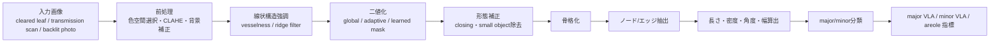
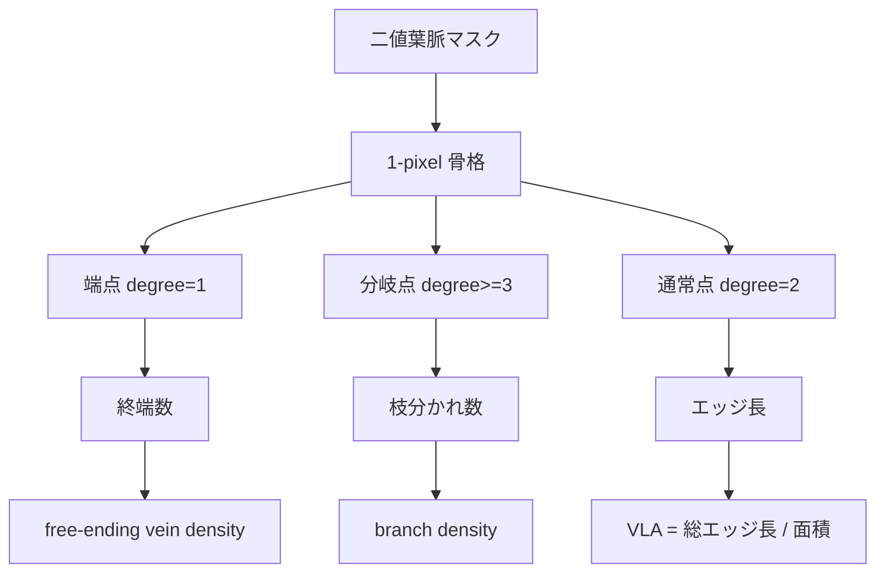
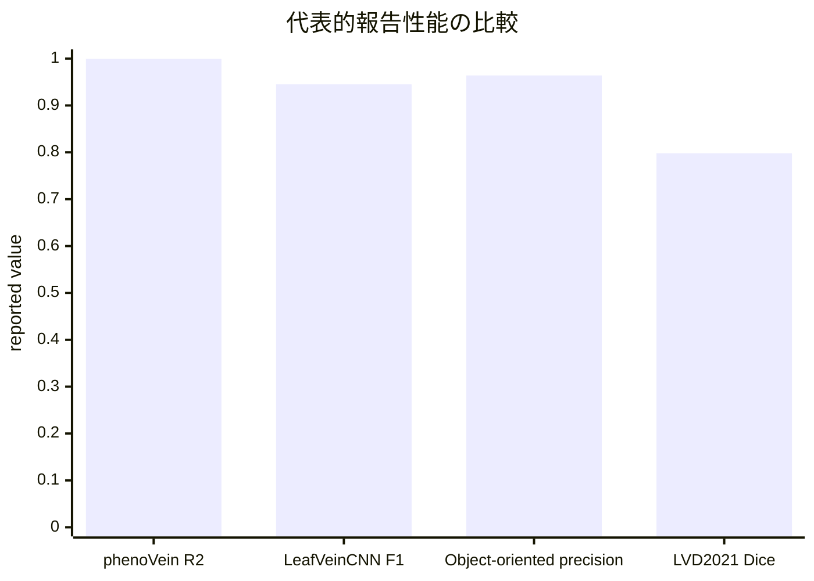

# 生態学研究における葉脈形質の測定方法とツール比較

## エグゼクティブサマリ

本報告は、対象植物群や取得装置が未指定であることを踏まえ、**一般的な被子植物の葉**を想定して、葉脈形質、とくに **major VLA** を最低限確実に取り、可能なら **minor VLA** まで扱うための測定法とツールを整理したものだ。結論を先に言うと、**major VLA を確実に取る**という目的だけなら、いまでも **手動ないし手動補正を含む方法が最も堅い**。一方で、**minor VLA まで安定して大量処理したい**なら、画像品質が十分高いことを前提に **phenoVein** か **LeafVeinCNN** 系、あるいはそれらの発想を取り込んだ **napari+Python 自作**が有力になる。citeturn7view2turn29view0turn17search0turn19search19

既存ツールのうち、**LeafJ は葉形測定用**であり葉脈解析ツールではない。**RhizoVision Explorer は根画像解析用**で、画像処理思想は参考になるが、葉脈の major/minor VLA をそのまま出す用途には向かない。**LEAF GUI** と **phenoVein** は古典的かつ重要な葉脈解析ソフトだが、原著ベースではどちらも **major/minor VLA を生態学の定義どおりに「直接」出す設計ではない**。そのため、**葉脈次数の明示的区別が必要な研究**では、結局どこかで手動規則か追加後処理が要る。citeturn31view0turn29view1turn30view0turn29view0turn44view0

**LeafVeinCNN** は、現状もっとも有望な高精度・高スループット側の選択肢で、報告上は **precision-recall harmonic mean 94.5% ± 6%** とされ、既存法を上回った。さらにネットワークの幅・角度・接続性や multiscale 統計まで扱えるので、将来的に major/minor VLA を超えるネットワーク指標へ拡張しやすい。ただし、標準配布物は MATLAB app / Windows 実行系ベースで、**研究室の Python 中心ワークフローとの統合性**では制約がある。citeturn17search0turn17search2turn11view1turn32view0

**napari+Python で自作する意義**はかなり大きい。理由は、葉脈次数の規則を自分で定義し、**major VLA を確実に出すための半自動ワークフロー**を組みやすいからだ。napari は画像・labels・points を重ねて可視化でき、プラグインは `napari.yaml` と widgets で拡張できる。scikit-image, OpenCV, networkx, PyTorch を組み合わせれば、**「自動候補生成 → ユーザー確認 → major/minor 切り分け → CSV 出力」**という研究実務向けの流れを作れる。既存ツールが弱い **対話的検証** と **custom 指標** の部分で、自作の利点が最も大きい。citeturn22search5turn22search1turn22search6turn24search13turn24search1turn22search2turn25search3turn22search3turn39search2

## 測定対象の定義と算出式

生態学で使う葉脈密度の基本量は **VLA**（vein length per unit leaf area, mm mm\(^{-2}\)）で、葉脈長を葉面積で割った値だ。PROMETHEUS の標準プロトコルでは、**major VLA = 1°・2°・3°葉脈密度の和**、**minor VLA = 4°以上の葉脈密度の和**と定義されている。したがって、代表的な書き方をすると、  
\[
\mathrm{VLA}_{total}=\frac{\sum_k L_k}{A},\quad
\mathrm{VLA}_{major}=\sum_{k=1}^{3}\frac{L_k}{A},\quad
\mathrm{VLA}_{minor}=\sum_{k\ge 4}\frac{L_k}{A^\*}
\]
となる。ここで \(L_k\) は次数 \(k\) の葉脈長、\(A\) は葉面積、\(A^\*\) は minor を測る視野面積で、プロトコル上は **3°葉脈以上が占める面積を分母から差し引くかどうか**に実務上の選択がある。つまり **minor VLA は分母設計まで含めて手順を固定しないと比較不能**になりやすい。citeturn7view2turn8view2

major/minor の切り分けは、生態学的には単なる太さの問題ではなく、**1°–3°を主骨格、4°以上を細網目**として扱う約束に基づく。PROMETHEUS では、たとえば 1°葉脈は petiole から出て葉縁方向へ向かう太い葉脈とし、2°葉脈と3°葉脈の判定も、単独の線幅だけでなく **その葉内での連続性とメッシュ形成パターン**で判断している。したがって、major/minor VLA の厳密測定では、**幾何学的閾値だけで完全自動分類するのは難しい**。citeturn8view1turn8view0

major/minor VLA を取る理由は機能生態学上も明確だ。大規模比較では、**major vein density は葉サイズと負にスケール**する一方、**minor vein density は葉サイズと有意にスケールしない**ことが示されている。さらに minor veins は総葉脈長の平均 **84%** を占めるため、**total VLA はしばしば minor 側に強く支配**される。そのため、「major VLA を最低限」取りたいという要件は、葉サイズ補正や力学・輸送骨格の比較には合理的だが、**水輸送や光合成との関係を見るなら minor 側を落とすと解釈が変わる**。citeturn33view2

major/minor VLA のほか、生態学で同時に取られることが多いのは、**free-ending vein density**、**branching point density**、**areole area / areole density**、**vein width / diameter**、そしてグラフ統計量だ。phenoVein の整理では、たとえば vein density は \(D_V=L/A\)、branching point density は \(N_{BP}/A\)、ending point density は \(N_{EP}/A\)、total vein area は \(\sum_i L_iW_i\) と表される。major/minor VLA を中心にしても、将来の解析を考えるなら、**骨格画像とグラフ構造を保存しておく**価値は高い。citeturn8view2

## 測定手法とアルゴリズム

葉脈測定は大きく、**手動**, **半自動**, **全自動**に分かれる。生態学の major/minor VLA では、いまでも **手動トレースが基準法**で、PROMETHEUS も 1°・2°・3°葉脈の測定や minor 視野の取り方をかなり明示的に規定している。一方、葉全体の網目構造や areole を大量処理したい場合、LEAF GUI、phenoVein、LeafVeinCNN のような半自動・全自動ツールが有利になる。citeturn8view1turn8view0turn30view0turn29view0turn17search0

iturn21image1turn21image6turn21image8turn21image0

上の図版は、典型的な入力画像のイメージを示す。古典的には **cleared leaf + 染色 + 透過照明**で major から minor まで見やすい網目を得る。近年は **バックライト付きフラットベッドスキャナの transmission mode** や、**光学写真 + 3D/マルチスペクトル**、**非破壊の light table + カメラ**も使われるが、fine minor veins の再現性は画像条件に強く依存する。citeturn35search4turn44view3turn35search13

古典的な半自動パイプラインは、ざっくり言えば **前処理 → 二値化 → モルフォロジー補正 → 骨格化 → 節点/枝検出 → 長さ・密度・角度・幅の算出**から成る。LEAF GUI は global / adaptive thresholding を備え、不均一照明には **局所平均との差分で前景判定する adaptive thresholding** を使う。phenoVein はさらに進んで、色空間選択、局所明るさ補償、**multiscale vesselness filter**、morphological closing、二値化、骨格化、必要に応じた手動修正を行う。Iwamasa らの高スループット法では、**CLAHE → 閾値化 → U-Net 学習**という流れでマスクを作っている。citeturn9view0turn44view3turn42view4turn25search1turn25search3turn23search1

LEAF GUI のネットワーク計測は、まず二値画像を **1-pixel 幅に skeletonize** し、branchpoint を node として抽出したうえで、**3 以上の近傍を持つ画素を外して edge を切り離し**、各 edge の長さと直径を求める。長さは水平/垂直隣接を 1、対角隣接を \(\sqrt{2}\) として積算する。phenoVein も skeleton 長を weighted pixel counting で算出し、width は threshold 依存の輪郭ではなく、**葉脈中心からの距離に対する輝度分布を half-Gaussian 的にフィットする model-based edge detection**で出す。つまり、**長さは骨格、幅は強度モデル**という役割分担になっている。citeturn9view1turn9view5turn9view6turn44view4

Deep learning 系では、問題設定が少し変わる。LeafVeinCNN は CNN で葉脈をセグメントしたあと、**空間グラフ表現**と **hierarchical loop decomposition** に進み、幅・角度・接続性や multiscale 統計まで扱う。LVD2021 では self-supervision により mIoU 71.02%、mean Dice 79.76% が報告され、HALVS はさらに **primary / secondary / tertiary の階層アノテーション**を備えたベンチマークを提供した。DL の利点は minor veins を含む複雑パターンの抽出能力だが、弱点は **位相切断**で、最近は DA-UNet や clDice のような **topology-preserving** な設計が重視されている。citeturn17search0turn17search2turn20search3turn20search8turn34search8turn41search2turn41search3

このフローは、LEAF GUI の thresholding + segmentation、phenoVein の vesselness + closing + skeleton、U-Net 系の learned mask を **1 本の研究実装フローに一般化**したものだ。citeturn9view0turn44view3turn42view4

この概念図が示すように、**major/minor VLA 以外の多くの指標は骨格グラフから一貫して導出**できる。だから自作する場合でも、最終的に欲しいのが VLA だけだったとしても、**内部表現を skeleton+graph にしておく**のが長期的には得だ。citeturn8view2turn9view1turn9view5

## 既存ツールの機能比較

まず前提として、**major/minor VLA を生態学プロトコルどおりに直接出す汎用 GUI は少ない**。多くのソフトは「葉脈網全体の長さ・密度・幅・areole」を出す設計で、**次数づけ**は別問題として残っている。major VLA を確実に取得したいなら、既存ソフトの選定では **“葉脈次数をどこで決めるか”** を最優先で見るべきだ。citeturn7view2turn30view0turn29view0turn44view0

| ツール / 系統 | 主用途 | 入力画像形式・解像度要件 | 主な出力 | major/minor VLA 対応 | 精度・検出率の報告 | 処理速度 | ライセンス / OS | 導入事例・引用 |
|---|---|---|---|---|---|---|---|---|
| **ImageJ / Fiji 手動トレース** | ゴールドスタンダード。次数ごと手動測定 | cleared leaf の高品質画像。PROMETHEUS は whole leaf と top/middle/bottom 視野の併用を推奨。citeturn8view1turn8view0 | 1°–3°長、4°+長、free-ending veins、直径 | **◎ / ◎**。最も定義に忠実。citeturn7view2 | 参照基準として使われる。phenoVein は完全手動分割と比較して R²=0.9996。citeturn14view0 | 遅い。phenoVein 比較では manual 20 min/葉。citeturn14view1 | ImageJ/Fiji はオープンソース、複数 OS | 生態学プロトコルの標準実務。citeturn6view4turn14view0 |
| **LeafJ** | 葉形測定 | ImageJ plugin。葉身・葉柄境界の半自動計測。citeturn31view0 | 長さ、幅、面積、周囲長、円形度 | **× / ×** | 葉脈精度報告なし。そもそも葉脈解析用ではない。citeturn31view0 | 軽量 | open-source / Win, Mac, Linux. citeturn31view0 | Arabidopsis 向け葉形測定。葉脈目的では非推奨。citeturn31view0 |
| **Leaf Venation** | 2D 葉脈パターン定量。旧来ソフト | Quantitative Plant では deprecated。Arabidopsis、MATLAB ベースの半自動。citeturn28view0 | venation, length, width, topology, surface | **○ / △**。次数別 VLA の直接出力は確認できない | 原著は 2D map 抽出が主眼。citeturn27search0turn28view0 | 不明 | licence on-demand / Win, Mac, MATLAB. citeturn28view0 | Rolland-Lagan et al. 2009。古典的だが現在は保守性に難。citeturn27search0turn28view0 |
| **LEAF GUI** | whole-leaf vein/areole 構造解析 | 葉脈が背景より強調された cleared leaf 画像。global/adaptive thresholding。citeturn30view0turn9view0 | network length, vein density, nodes, edges, areoles, 位置・形状 | **○ / △**。全葉脈密度は可、major/minor 直出しは弱い | 原著は代表例で whole-leaf 計算 58–84 s、設定によって 190–264 s。後年の議論では画質と threshold artifact が精度を左右。citeturn14view6turn37search4 | 中速 | freeware / Win, Mac, MATLAB. citeturn30view0 | Price et al. 2011。全葉網構造の解析に広く引用。citeturn8view3turn30view0 |
| **phenoVein** | 自動葉脈セグメンテーション + 手動補正 | 顕微鏡・マクロ写真・高解像 whole-leaf。Arabidopsis では transmitted background illumination、約 5.7 µm/px。density は約 400 dpi 以上、width は 3000 dpi 以上で安定。citeturn29view0turn44view2turn44view3 | vein length, density, piecewise length/width, areole area, branching/ending points, skeleton overlay | **○ / △**。次数自動分類は未実装。manual segmentation 併用で major VLA は現実的。citeturn44view0 | manual segmentation に対して R²=0.9996。回転角依存は vein density 0.8% 未満。citeturn14view0turn44view2 | 約 1–2 min/葉。citeturn14view1 | open-source, freeware / Windows. citeturn29view0 | Bühler et al. 2015。変異体 Arabidopsis の葉脈形質解析。citeturn6view1turn29view0 |
| **RhizoVision Explorer** | 根画像解析。葉脈ではなく参考系 | 高コントラスト・均一照明・重なり最小の画像を想定。Qt + OpenCV。citeturn29view1turn13search3 | 長さ、直径、体積、角度、convex hull, batch 処理 | **× / ×**。葉脈次数・VLA 向けではない | 銅線 ground truth や simulated roots で広く妥当性確認。citeturn29view1 | 高速、バッチ向き | GPL / Windows（ソースは GitHub）。citeturn13search3turn29view1 | 葉脈には直接非推奨。ただし batch GUI と skeleton 設計は自作時の参考になる。citeturn29view1 |
| **LeafVeinCNN** | CNN ベース葉脈抽出と multiscale network 解析 | 学習済み CNN は 1.68 µm resolution モデル同梱。MATLAB app / Windows 実行系。citeturn11view1turn14view7 | vein segmentation, spatial graph, widths, angles, connectivity, multiscale stats, HLD | **○ / △**。direct な major/minor VLA より、幅階層・multiscale 指標が強い | precision-recall harmonic mean **94.5% ± 6%**。既存抽出法より高性能。citeturn17search0turn17search2 | 高スループット向き。parallel beta あり。citeturn32view0 | CC BY software / MATLAB 2020b+ または Windows 11 exe. citeturn11view1 | tropical 50 families, >700 leaves から学習。近年の葉脈機能解析でも利用。citeturn15search4turn10search11 |
| **Deep learning custom** | U-Net / self-supervision / hierarchy-aware 研究実装 | LVD2021: 4977 images, 2736×3648, 36 leaf types。HALVS: 5057 high-res scans, 3 species, 1°–3°アノテーション。citeturn20search3turn20search0turn34search8 | segmentation mask, hierarchy labels, custom topology metrics | **◎ / △** まで拡張可能。HALVS 系なら major に強く、minor は追加学習が必要 | LVD2021 self-supervision: mIoU 71.02%, mean Dice 79.76%。HALVS/DA-UNet/LCET は topology preserving を前面化。citeturn20search8turn41search3turn34search0 | 学習後は高速 | 実装依存。PyTorch/TensorFlow 中心 | 研究用途として最も拡張性が高い。既製 GUI より開発負担は大。citeturn20search10turn34search8 |
| **VeinViewer** | **植物葉脈ソフトではなく医療用静脈可視化装置** | 近赤外で皮下静脈を投影表示する医療デバイス。citeturn45search14 | 血管可視化 | **× / ×** | 葉脈解析の学術ソフトとしては本調査で採用不可 | ـ | 医療機器 | 植物葉脈ツール比較の対象には不適切。名称の混同に注意。citeturn45search14 |

この表から実務上の結論を出すと、**major VLA を確実に取るだけなら「ImageJ/Fiji 手動基準」か、それを napari で置き換えた半自動実装**が最も堅い。**minor VLA も含めて大量処理**したいなら、既製ソフトでは **phenoVein** か **LeafVeinCNN**、ただし前者は次数分類が未実装、後者は MATLAB 依存が残る。だから **major VLA 必須 + 自前ルールで minor 追加 + Python 中心**という条件では、napari+Python 自作の妥当性が高い。citeturn29view0turn11view1turn44view0turn24search13

## 精度評価と公開データセット

葉脈測定の精度評価は、少なくとも **二つのレベル**で行う必要がある。第一は **mask/skeleton のセグメンテーション精度**、第二は **生態学指標としての VLA や幅の測定精度**だ。phenoVein は後者の代表で、完全手動分割に対する **R²=0.9996** を示した。一方、LeafVeinCNN や self-supervised segmentation は前者の代表で、**F1, precision-recall harmonic mean, IoU, Dice** が主に使われる。両者は同じ「精度」でも意味が違う。citeturn14view0turn17search0turn20search8

公開ベンチマークとして重要なのは **LVD2021** と **HALVS** だ。LVD2021 は **4977 枚、36 葉型、2736×3648 px、pixel-level annotation** を持つ初期の公開セットで、self-supervision 法はこのデータで **mIoU 71.02%、mean Dice 79.76%** を報告した。HALVS はさらに進んで、**5057 枚、3 種、primary/secondary/tertiary veins の階層アノテーション**を備え、**83.8 person-days** のラベリングコストを明示した。major VLA の自動化、つまり **1°–3°葉脈の階層抽出**を考えるなら、HALVS 系はまさに必要な教師データの形に近い。citeturn20search3turn20search8turn34search8turn20search1

高スループットの非破壊撮像系としては、Iwamasa らの **light table + digital camera + non-reflective glass** の workflow が実装性の高い中間解になる。彼らは **U-Net + skeletonization + undirected graph + network feature calculation** の流れを構築し、種分類課題で **90.6% accuracy** を示した。これは VLA の直接検証ではないが、**未処理葉でも葉脈ネットワークを安価に再現可能**であることを示している。citeturn42view4turn42view1

誤差要因としては、**照明むら**, **葉厚のむら**, **trichomes, dirt, leaf damage**, **低解像度**, **交差部の切断・誤接続**, **スケール較正ミス**が主要だ。phenoVein は vesselness filter によって brightness gradients への頑健性を上げ、さらに manual correction を許している。逆に言えば、**自動法の勝負は「前処理でどこまで補正し、どこから人手に戻すか」**にある。citeturn44view0turn44view3

位相を保つ評価指標も重要だ。葉脈は細い network-like structure なので、単純な Dice だけでは **つながりの切断**を十分に罰せない。clDice は segmentation mask と skeleton の交差に基づく指標で、**tubular / network-like structure の topology preservation**を重視する。葉脈 segmentation で recent deep learning が topology-preserving を強調するのは、この事情による。citeturn41search2turn41search0turn41search3

この棒グラフは文献報告値を並べたものだが、**R², F1, precision, Dice が混在しており、厳密な同列比較ではない**。それでも、**測定値検証では phenoVein が強く、画像 segmentation では LeafVeinCNN と object-oriented 法が高く、汎化性のある公開ベンチマークでは LVD2021 系がまだ伸びしろを残す**、という全体像は把握できる。citeturn14view0turn17search0turn33view4turn20search8

## napari+Pythonで自作する意義と実装案

napari+Python 自作の最大の意義は、**生態学側の定義を第一級市民として扱える**ことだ。既存葉脈ソフトの多くは「全葉脈網の定量」を強く意識しており、**major VLA を 1°–3°葉脈の長さ/面積として厳密に固定**したいときには、内部処理をこちらが支配できるほうが有利になる。napari 自体は多次元画像ビューアで、画像上に **labels layer**, **points layer** を重ねて編集でき、プラグインは **manifest (`napari.yaml`)** と widget で配布できる。つまり、**自動抽出結果を可視化しながら、人が次数境界だけ修正する** UI を作りやすい。citeturn22search5turn22search1turn22search6turn24search13turn24search1

実装アーキテクチャは、つぎのように分けると扱いやすい。画像 I/O には napari reader と NumPy ベースを使い、前処理では **CLAHE / background correction / threshold_local / Frangi などの ridge enhancement** を scikit-image と OpenCV で行う。二値マスクからの skeleton 化は scikit-image の `skeletonize` / `medial_axis`、graph 化は networkx、必要なら skeleton-to-graph の補助に **sknw** が使える。region props は scikit-image と `napari-skimage-regionprops`、ImageJ 資産の再利用には `napari-imagej` が橋渡しになる。 DL を取り込むなら PyTorch の U-Net が素直だ。citeturn25search1turn25search3turn22search2turn22search7turn22search3turn22search13turn39search3turn39search2turn22search4

| 実装層 | 推奨要素 | 役割 |
|---|---|---|
| 画像 I/O・閲覧 | napari reader / image layer | whole leaf、ROI、overlay の可視化。citeturn22search5turn39search9 |
| QC 編集 | labels / points / shapes + magicgui | 自動 mask の修正、major vein pointer、ROI 指定。citeturn22search1turn22search6turn24search1 |
| 前処理 | scikit-image, OpenCV | CLAHE、local threshold、morphology、ridge detection。citeturn25search1turn25search3turn23search1turn23search9 |
| 骨格・グラフ | scikit-image, networkx, sknw | skeleton、degree、edge length、branch count。citeturn22search2turn22search3turn22search13 |
| DL セグメンテーション | PyTorch / TensorFlow | minor veins の抽出強化、hierarchy-aware 学習。citeturn22search4turn20search3turn34search8 |
| 既存資産接続 | napari-imagej | Fiji / ImageJ マクロや既存 plugin の再利用。citeturn39search2turn39search10 |

開発工数は、major VLA をどこまで自動化するかで大きく変わる。以下は**推定**だが、かなり実務的に使える目安だ。

- **低**: 既存 classical 処理だけで、major veins を半自動抽出し、手で修正して VLA を出す napari widget。研究室内ツールなら十分現実的。
- **中**: 画像ごとのスケール校正、ROI 管理、mask 編集、graph 抽出、CSV 一括出力まで含む plugin。major VLA を再現可能に回すならこの層が本命。
- **高**: minor veins まで含む hierarchy-aware DL、公開配布、テスト、モデル管理、再学習 UI まで含む系。ここまで行くと既製ソフト 1 本分に近い。

利点は、**拡張性**, **対話的検証**, **custom 指標**, **Python 生態系との接続**だ。反対に欠点は、**検証責任が自分に来ること**, **保守負担**, **画像解析と GUI の学習コスト**, **論文 reviewer に対して自前法の妥当性説明が必要**なことだ。これらは napari/plugin 生態系や既存ツールの機能から自然に導かれる判断で、特に **major/minor の定義を独自に持ちたい研究**でない限り、既存ソフトを使うほうが楽な場合は多い。citeturn24search13turn24search1turn39search2turn39search3turn29view0turn11view1

推奨ワークフローは、いきなり DL から入るより、**段階導入**がよい。  
**第1段階**: transmitted scan / cleared images で major veins を classical 法で抽出し、manual correction を通して VLA を出す。  
**第2段階**: skeleton と graph を保存し、branch / areole / free-ending traits を自動出力する。  
**第3段階**: minor veins が必要になった時点で U-Net 系セグメンテーションを差し込み、major/minor 分離は UI 上で半自動補正する。  
この順にすると、**最初の論文化に必要な再現性**と **後の拡張性**を両立しやすい。citeturn44view0turn42view4turn24search1turn17search0

## 推奨と実践ガイド

研究目的別の推奨は明確だ。**高精度研究**で major/minor の定義を厳密に守りたいなら、**ImageJ/Fiji 手動基準**か **napari 半自動自作**を軸にするべきだ。**ハイスループット**なら **LeafVeinCNN** が最有力で、画像が均質なら **phenoVein** も良い。**教育用途**や全葉網の直感的理解には **LEAF GUI** が入りやすい。**非専門家向け**で major VLA だけを最低限出したいなら、むしろ **既存 GUI より、major veins だけを対象にした簡素な napari ツール**のほうが誤用が少ない可能性が高い。citeturn30view0turn29view0turn11view1turn24search1turn24search13

**major VLA を確実に取る撮影条件**としては、第一選択は **clearing + staining + transmitted illumination** だ。2025 protocol は clearing, staining, mounting, imaging, archiving を一体で示し、染色は **ethanol dehydration を伴う safranin**、mounting は **xylene-based medium** を採る。phenoVein の撮像例でも、**暗室・透過背景照明のみ**で取得している。非破壊寄りなら、HALVS や Iwamasa workflow のような **backlit transmission scan / light table + camera** が現実的だが、minor 側は画質依存が強い。citeturn37search1turn44view3turn35search4turn42view4

**解像度の実務基準**は、文献から直接一律には決まらない。だが、phenoVein では Arabidopsis で **約 400 dpi 未満だと thin structures の消失で VLA が低下**し、**width は 3000 dpi 以上**で安定した。別の近年研究では、**47–144 px/mm** の whole-leaf 画像で **≥10 μm の veins** を解像できた一方、より細い minor veins は種によって取りこぼし得るとされた。したがって、**major VLA だけなら 400–1200 dpi 相当の transmitted scan /高品質マクロ写真で始める**、**minor VLA を本気で取るなら finest vein が少なくとも 2–3 pixel 以上で見える条件を確保**、という保守的運用が妥当だ。これは文献報告を踏まえた実務的な推奨だ。citeturn44view2turn44view4turn15search13

**初期前処理パラメータ**は画像依存なので、固定値より「出発点」を持つほうがよい。以下は **推奨初期値**で、phenoVein・Iwamasa workflow・scikit-image/OpenCV のアルゴリズム仕様から引いた **ヒューリスティック**だ。  
CLAHE は clip limit 小さめ、局所二値化は **51–101 px 程度の block size**、ridge enhancement は **1–4 px 程度の sigma**、closing は **1–2 px**、small object 除去は **20–50 px** あたりから試行を開始するのがよい。重要なのは、最初から minor veins を全部取りに行かず、**major veins が切れない条件を最優先**にすることだ。局所二値化の `block_size` や `offset`、Frangi/Hessian 系の ridge filter は、まさにその調整のためにある。citeturn25search1turn25search3turn23search9turn44view3turn42view4

major VLA を確実に出すなら、検出パラメータは **「誤検出を減らす」より「主脈・2°・3°を切らない」** 方向に寄せるべきだ。細い偽陽性は後で除去できるが、切れた主骨格の復元は難しい。phenoVein が closing によって crossing の dark gaps を埋めるのもそのためだ。major veins を最優先にするなら、**closing は弱めに一回**, **remove_small_objects は少し大きめ**, **手動修正は major skeleton に限定**という思想が運用しやすい。citeturn44view3turn44view0

品質管理は、少なくとも次のチェックを毎バッチで回すべきだ。

- **次数の定義固定**: 1°–3°と4°+の規則を文書化し、曖昧な vein は判断ルールを残す。citeturn8view1turn8view0
- **scale calibration**: 画像ごとに mm/px を記録し、スケールバーや marker で検証する。citeturn44view0turn42view4
- **major skeleton の連結性**: crossing や junction で途切れていないかを見る。citeturn44view3turn9view1
- **artifact 点検**: trichomes, dirt, 破損, 背景むらの影響を overlay で確認する。citeturn44view0turn9view8
- **手動基準との照合**: まず 10–20 葉を人手でトレースし、自動値との回帰と Bland–Altman 的なずれを確認する。phenoVein 方式の manual comparison はそのまま参考になる。citeturn14view0turn14view1

最終的な推奨を一文でまとめるとこうなる。  
**major VLA が最低限必要**で、後から minor も視野に入れるなら、現時点では **「高品質透過画像 + napari 半自動 + 手動次数確認」** が最も堅い。既製ソフトを使うなら **phenoVein** が近いが、**次数分類未実装**がネックになる。**大量処理と将来拡張**を重視するなら **LeafVeinCNN か Python 自作**に振るべきで、その場合も最初の論文化では **major VLA の手動基準検証**を必ず併走させるのがよい。citeturn29view0turn44view0turn11view1turn17search0turn14view0