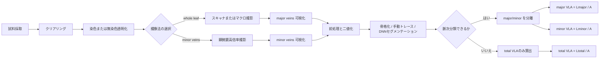

# 葉脈形質の測定法と既存ツールの比較報告

## エグゼクティブサマリ

葉脈密度指標としての VLA（vein length per leaf area）は、**total VLA = すべての葉脈長 / 葉面積**が基本であり、実務上とくに重要なのは **major VLA = 1–3 次脈長 / 葉面積**、**minor VLA = 4 次脈以上の脈長 / 葉面積**である。総 VLA は多くのツールで扱えるが、**major/minor をそのまま分離して算出できる既存ツールは少ない**。今回調べた範囲では、**標準的かつ最も厳密なのは ImageJ/Fiji を用いる手動トレース系**であり、**major/minor VLA を「直接」得るには、手動の脈次分類、または階層ラベル付きセグメンテーション結果に対する追加計算**がほぼ必須だった。phenoVein、LEAF GUI、LeafVeinCNN、eCognition 法、最近の DL 法は、総 VLA や脈幅、分岐点、アレオールなどの定量では有用だが、**major/minor VLA をワンクリックで出す設計にはなっていない**か、あるいは **主脈のみ**を対象にしている。[^prometheus-vein-traits]

実用上の結論は明確である。**最低限 major VLA を確実に取りたい**なら、(a) cleared leaf を作成し、(b) whole-leaf の低倍率像と intercostal 領域の高倍率像を併用し、(c) ImageJ/Fiji で major/minor を分けてトレースする方法が、現在でも最も再現性が高い。**高スループットで total VLA や network traits を取りたい**なら phenoVein または LeafVeinCNN が第一候補で、**主脈中心のリアルタイム計測**なら MobileNetV2-DeepLabV3+ 系が候補になる。ただし後者は論文自身が「主脈中心」と明記しており、minor VLA 取得には向かない。**hierarchical major/minor を自動化したい**場合は、HALVS 系の階層セグメンテーションが最も将来性があるが、現状は研究コード／データセットの性格が強く、VLA 指標の最終算出は自作後処理が必要である。[^sack-2014][^buhler-2015][^leafveincnn-zenodo][^liu-2022][^halvs]

一方、ユーザー指定のツールのうち **LeafJ は葉形計測用で葉脈密度には非対応**、**RhizoVision Explorer は root 向けで off-label では使えても葉面積規格化や major/minor VLA の標準機能はない**、**VeinViewer は医療用静脈可視化装置で植物葉脈解析ツールではない**。したがって、これらは比較対象には含めるべきだが、**葉脈 VLA 測定の中核候補ではない**。[^leafj][^rhizovision-install][^rhizovision-cite][^veinviewer]

## 調査範囲と評価基準

本報告では、要求された必須項目として **major VLA を最低限取得したい**という条件を中心に、可能なら **minor VLA** も含めて評価した。major/minor の定義は、近年の生理生態系の文献で一般的な **major = 1–3 次脈、minor = 3 次超または 4 次以上**に揃えた。total VLA はその和として扱った。文献上も、major VLA と minor VLA を葉面積当たりの脈長として分け、total VLA を両者の和として定義する例が多い。[^li-2024]

比較軸は、依頼内容に従って次の通りに統一した。すなわち、**前処理**（クリアリング、染色、透過/反射、非破壊計測の可否）、**画像取得法**（スキャナ・顕微鏡・マクロ/カメラ・3D）、**解像度要件**、**ソフトウェア名とバージョン**、**入力形式**、**処理ワークフロー**、**自動化レベル**、**出力指標**、**major/minor VLA の算出可否と方法**、**精度・検出限界**、**計算時間**、**必要ハードウェア**、**ライセンス/費用**、**長所・短所**、**利用例**である。なお、ツールによっては最新版が継続配布されていても、論文で検証された版と異なることがあるため、**可能な限り「論文版」と「現在配布版」を分けて記した**。[^phenovein-software]

この主題では、「測れること」と「厳密に測れること」を区別する必要がある。総脈長や骨格長、分岐点数を返すツールは多いが、**major/minor VLA は脈次の判別が前提**であり、単に二値化・骨格化するだけでは直接は得られない。そのため、報告中では各ツールについて **直接算出可**、**間接的に可**、**不可** を明示した。[^buhler-2015]

## major VLA と minor VLA を厳密に測るための標準設計

葉脈 trait の標準的な実験設計は、cleared leaf を作成して葉脈を可視化し、**whole-leaf で major vein を、代表的な lamina サブサンプルで minor vein を測る**という二段構えである。PROMETHEUS の標準プロトコルでも、葉脈密度、各脈次の脈径、自由終端脈数などを取得する前提として clearing と imaging を行うことが示されている。さらに Sack らは、葉全体を高倍率で一様に解像することは多くの種で非現実的であり、**major vein は whole-leaf cleared scan から、minor vein は lamina の高倍率サンプルから**測るのが現実的だと述べている。[^prometheus-vein-traits][^sack-2014]

前処理では、研究室プロトコルとして **5% NaOH による長時間クリアリング、漂白、サフラニン O 染色、グリセロール封入後のスキャン**が広く使われる。Cavender-Bares Lab の手順では、NaOH 処理後に漂白し、0.05% Safranin O in ethanol で染色、グリセロールでマウントしてスキャンしている。別の自動法では、5% NaOH で 7 日間透明化し、toluidine blue で染色して 40× 顕微鏡撮影を行っている。つまり、**major/minor を厳密にとる研究では clearing + 染色 + 透過系撮影が依然として主流**である。非破壊・反射撮影・3D 法も出てきたが、現時点では総 VLA に強く、major/minor の厳密分離ではまだ補助的である。[^cavender-bares-vla][^zhu-2020][^liao-2025]

解像度要件にも注意が必要である。phenoVein では **脈長と VLA は約 400 dpi 以上で安定**し、**脈幅推定は 3000 dpi 以上**、かつ**対象脈幅が少なくとも 5 pixels** は必要と報告されている。LEAF GUI をめぐる検証では、**低品質・低倍率・ダウンサンプリング画像が大きな誤差源**であり、十分に脈が判別できる画質が必要とされた。ImageJ 手動法の実務プロトコルでも、minor vein 判読のために**画面上で少なくとも 600× まで拡大して確認**するよう指示されている。つまり、major/minor を分けるほど細い脈次まで扱うなら、dpi の数字だけでなく、**最細脈が何 pixel で表現されるか**が本質的な基準になる。[^buhler-2015][^sack-2014]

このフローの重要点は、**major/minor VLA の分離は「脈次分類」工程に依存する**ことである。phenoVein や LEAF GUI のように総脈長や edge 情報を返すツールでも、脈次を自動分類しない限り出力されるのは total VLA であり、major/minor は手動または追加アルゴリズムが必要になる。逆に、HALVS のような階層ラベル付き手法は major/minor への道筋を提供するが、面積正規化と最終集計は別途実装する必要がある。[^buhler-2015][^halvs]

## ツール比較表

| ツール | 現行/代表版 | 前処理・撮像 | 入力形式 | 自動化 | 主な出力 | major VLA | minor VLA | 精度・限界・時間 | ライセンス/費用 | 既存利用例・判定 |
|---|---|---|---|---|---|---|---|---|---|---|
| **ImageJ 手動トレース** | ImageJ 1.44o が古典的参照、現行 ImageJ 1.54t | cleared leaf、scan/顕微鏡、代表領域 crop | TIFF など一般画像 | 低 | ROI 長さ合計、面積、任意の order 別長さ | **直接可** | **直接可** | 最も厳密だが手間大。代表プロトコルでは 600× 視認で tracing。[^sack-2014] | オープンソース・無償 | Sack らの標準法。**gold standard**。 |
| **Fiji + AnalyzeSkeleton** | Fiji同梱、AnalyzeSkeleton 初版2008 | 事前に二値化・骨格化済み画像 | 2D/3D skeleton binary | 中 | branch 数、junction、平均/最大 branch 長 | **間接的に可** | **間接的に可** | 脈次分類機能なし。branch length 集計は可能。[^analyze-skeleton] | Fiji 無償 | 葉脈専用ではないが after-skeleton 解析に有用。 |
| **Fiji + Vessel Analysis** | v1.1 | RGB vascular network 画像 | Fiji で扱える一般画像 | 中 | vascular density、vascular length density、径 | **不可** | **不可** | 面積密度と長さ密度は返すが leaf vein order 非対応。[^vessel-analysis] | 無償 | 血管向け。葉脈への転用は可能でも標準外。 |
| **LEAF GUI** | 論文版 2011、公開版番号不詳 | cleared leaf、veins enhanced image | RGB cleared-leaf image | 中 | total network length、vein density、edge width、areole traits | **間接的に可** | **間接的に可** | 低画質/ダウンサンプリングに弱く、アルゴリズム由来誤差が検証で指摘。計算は例で 58–84 s 程度。[^price-2011] | academic free / freeware | Price ら 2011。**total VLA 向け、order 別は追加処理前提**。 |
| **phenoVein** | phenoVein 1.0 | 顕微鏡/マクロ、bright- or dark-field、cleared leaf が典型 | jpg, png, 8/16-bit tif, bmp | 高 | total vein length、vein density、piecewise length/width、areole area、branch/end points | **間接的に可** | **間接的に可** | 長さは手動と R²=0.9996、1–2 分/葉、角度依存 <0.8%、VLA は約400 dpi以上、幅は3000 dpi以上。[^buhler-2015] | BSD-3、無償。MeVisLab 背景動作、Windows 版中心。[^phenovein-software] | Bühler ら 2015。**現実的な total VLA 本命**。 |
| **LeafVeinCNN** | v2.14.00 | 高解像度葉脈画像、cleared image が主 | Matlab app / Windows exe、画像一般 | 高 | vein segmentation、graph extraction、多尺度 network statistics | **間接的に可** | **間接的に可** | 学習済みモデルは 1.68 µm 解像度。MATLAB 2020b+ と DL/画像処理/並列 toolbox が必要な構成あり。[^leafveincnn-zenodo] | ソフトは無償配布、MATLAB 構成では有償環境が必要。Windows standalone あり。 | Xu ら 2020、Blonder ら 2020。**high-throughput total/network 向け**。[^blonder-2020] |
| **eCognition object-oriented 法** | eCognition Developer 64 | 5% NaOH 透明化 + toluidine blue、40× 顕微鏡 | 顕微鏡画像 | 高 | batch total vein density | **不可** | **不可** | 9種平均精度 >96.40%、計算速度は ImageJ 比で >87.3% 向上。主に total density。[^zhu-2020] | 商用 | Zhu ら 2020。**batch total VLA 専用に近い**。 |
| **MobileNetV2-DeepLabV3+ 法** | 2022 論文実装 | RGB 葉画像、主脈中心 | 512×512 RGB | 高 | main vein segmentation、length、width | **限定的に可** | **不可** | MIoU 81.50%、mPA 92.89%、9.81 fps、長さ精度 96.3642%、幅 96.1358%。ただし論文は「主脈」を主対象とする。[^liu-2022] | 研究実装 | Liu ら 2022。**major-only 近傍**。 |
| **HALVS 階層セグメンテーション** | IJCAI 2024 / Plant Phenomics 2026 | high-resolution scanned leaves | 研究用データセット/コード | 高 | 1°–3° vein masks | **間接的に可** | **間接的に可** | 5,057 枚、3種、3オーダー GT。VLA は直接出さないが、order mask から算出可能。[^halvs] | GitHub/研究コード | Liu ら 2024/2026。**major/minor 自動化の最有力研究系**。 |
| **TTH-Net** | 2023 | 葉脈 segmentation dataset | 研究実装 | 高 | 高精度 vein segmentation | **不可** | **不可** | segmentation SOTA を主張するが order 分離も VLA 直接出力もない。[^tthnet] | 研究実装 | Song ら 2023。**前段セグメンテーション用途**。 |
| **3D multispectral + DFP 法** | 2025 | 非破壊、非平坦 leaf、multispectral + 3D | grayscale/multispectral/3D point cloud | 高 | leaf area、vein length、total VLA | **不可** | **不可** | 1936×1464 camera、120 Hz、VLA は 2D flatten 法と <3% 差。major/minor は未実装。[^liao-2025] | 研究システム | Liao & Zhang 2025。**非破壊 total VLA 向け**。 |
| **LeafJ** | ImageJ plugin、版番号不詳 | 葉形の写真/スキャン | ImageJ 対応画像 | 中 | petiole length、blade area、perimeter、circularity | **不可** | **不可** | 葉脈解析ツールではない。[^leafj] | 無償 | Maloof ら 2013。**対象外に近い**。[^leafj-paper] |
| **RhizoVision Explorer** | 配布 2.0.3、repo 2.5.0 changelog | 高コントラスト branching image、root 想定 | PNG/JPG/BMP/TIF など | 高 | root length、diameter、topology | **不可** | **不可** | root 専用設計。off-label の leaf vein demo はあるが標準葉面積/VLA 機能なし。[^rhizovision-install] | GPL、無償 | Seethepalli ら 2021。**葉脈 VLA 用の標準選択ではない**。[^rhizovision-cite] |
| **VeinViewer** | 医療機器製品 | 近赤外リアルタイム投影 | NIR hardware | 高 | 皮下血管可視化 | **不可** | **不可** | 臨床静脈可視化であり植物葉脈 trait 測定には不適。[^veinviewer] | 商用医療機器 | 植物葉脈ツールではない。 |

## 主要ツールの個別分析

### ImageJ と Fiji はなぜ依然として基準法なのか

ImageJ の手動トレース法は、自動化レベルこそ低いが、**major/minor VLA を厳密に分けたいという今回の要件には最も適合**する。理由は単純で、ユーザーが 1 本ずつ tracing するため、**脈次の判定を人間が直接反映できる**からである。Sack らは LEAF GUI と比較する際の基準法として ImageJ 1.44o による digital tracing を採用しており、標準法として扱っている。研究室実務プロトコルでも、代表領域を crop し、midrib を避け、必要なら 600× 以上まで拡大しながら tracing し、最終的に長さ合計を面積で割って VLA を計算する。[^sack-2014]

この方法の長所は、**major/minor を直接返せること、画像品質の問題を人間判断で吸収できること、論文間の比較可能性が高いこと**である。短所は、**時間がかかること、作業者差が出うること、高スループットに向かないこと**である。したがって、major VLA を最低限確実に取るという要件なら最有力だが、何百〜何千枚の処理には向きにくい。Fiji の AnalyzeSkeleton は、この手動または外部セグメンテーション後の skeleton から branch 数・平均長などを追加抽出する補助として有用であるが、**脈次分類そのものはしない**。[^analyze-skeleton]

### LEAF GUI は総 VLA とネットワーク記述には強いが major/minor 直出しではない

LEAF GUI は MATLAB で作られた stand-alone の academic free ソフトで、thresholding・cleaning・segmentation により cleared leaf の vein network と areole を抽出し、**総 network length、vein density、network area、edge length/width、areole statistics** を返す。whole-leaf statistics の例では、計算時間はサーバで 58–84 秒、より遅いラップトップでは 190–264 秒程度と報告されている。[^price-2011]

ただし major/minor VLA については、LEAF GUI 自体が脈次分離を標準機能として持つわけではない。後年の論文でも LEAF GUI で venation information を抽出した後、**別法に基づいて vein levels を分ける**という使い方が見られる。さらに Sack らの検証では、低品質・低倍率画像や downsampling、さらに LEAF GUI のアルゴリズム上の artifact により VLA の見かけ上の増加や 5%以上の誤差が生じうると指摘された。よって LEAF GUI は、**cleared whole-leaf の total VLA・areole 記述には有用だが、major/minor の厳密測定には単独では不十分**という評価になる。[^sack-2014]

### phenoVein は total VLA 用の実用解として最もバランスがよい

phenoVein は顕微鏡画像・マクロ画像の両方を扱える葉脈専用ツールで、**leaf/background 分離、vesselness filtering、二値化・骨格化、目視確認と任意修正、脈長評価、脈幅推定**という明快なパイプラインを持つ。jpg、png、8/16-bit tif、bmp を読め、明視野・暗視野いずれ由来の画像にも対応する。manual correction がしやすい点が強みである。[^buhler-2015]

出力は、**total skeleton length、projected leaf area、vein density、piecewise vein length/width、branching point 密度、ending point 密度、areole 数・面積**など非常に充実している。一方で、論文本文が明示する通り、**automated classification of vein orders は実装されていない**。したがって major/minor VLA は、出力 skeleton や手動指定した vein pieces を利用して**追加分類・再集計すれば可能**だが、標準ボタンでは出ない。[^buhler-2015]

性能面では、length measurement は手動 segmentation と **R² = 0.9996**、leaf 1 枚あたり **1–2 分**、葉サイズ・画質によっては **1–4 分**で、角度依存も VLA で **0.8% 未満**と小さい。解像度は VLA なら約 400 dpi 以上、width は 3000 dpi 以上が必要で、width 推定には少なくとも 5 pixels 幅が望ましい。したがって、**major/minor の自動分離を要しない total VLA 計測では、phenoVein が現在でも非常に強い選択肢**である。ソフトは phenoVein 1.0 が Windows 版 MeVisLab 上で動き、BSD-3 で公開されている。[^buhler-2015][^phenovein-software]

### LeafVeinCNN と最近の機械学習系は高スループットに強いが major/minor は追加実装が前提

Xu らの LeafVeinCNN 系は、葉脈画像に対して CNN で segmentation を行い、その後 graph extraction と multiscale network statistics へ進む枠組みである。現在の配布版は **v2.14.00** で、学習済みモデルは **1.68 µm resolution** の画像に基づき、MATLAB app 版では MATLAB 2020b 以降と Deep Learning / Image Processing / Parallel Computing toolbox を要求する。Windows standalone 版も配布されている。研究対象としては、総脈ネットワークや階層ループ分解、multiscale traits の抽出に強い。[^leafveincnn-zenodo][^blonder-2020]

ただし、この系統のツールも **major/minor VLA を直接返すわけではない**。graph は得られるため、太さや位置、階層推定を追加すれば order 別 VLA に進めるが、標準配布物の中心は total/network-level traits である。したがって、**既に高解像度 cleared image があり、大量サンプルの total VLA や network topology を高速に取りたい研究**には向くが、今回のように major VLA を必須とする設計では、そのままでは不十分である。[^blonder-2020-multiscale]

最近の DL 手法の中では、**MobileNetV2-DeepLabV3+ 法**と**HALVS 系階層セグメンテーション**を分けて考えるべきである。前者は MIoU 81.50%、mPA 92.89%、9.81 fps、長さ 96.3642%、幅 96.1358% と高速だが、論文自身が **“main veins” を主対象**としており、minor VLA 取得には使えない。後者は 1°–3° の階層ラベルを持つ 5,057 枚の高解像度 dataset を提供し、**major/minor を自動化する唯一の本格的方向性**を示すが、最終的な VLA 集計は利用者の後処理に依存する。TTH-Net は segmentation 精度向上には有用でも、order 別 VLA には直接つながらない。[^liu-2022][^halvs][^tthnet]

### eCognition 法は batch total VLA に特化した商用ルート

Zhu らの object-oriented classification 法は、顕微鏡画像を remote sensing 的に扱い、eCognition Developer 64 で multiscale segmentation とルールベース分類を行う。試料は **5% NaOH 透明化、toluidine blue 染色、40× 顕微鏡撮影**で、9 樹種で **平均精度 96.40%以上**、計算速度は従来の ImageJ 手動法より **87.3%以上向上**した。[^zhu-2020]

ただしこの方法が返すのは本質的に **total leaf vein density** であり、major/minor の order 分離は想定していない。またソフトは商用である。したがって、**大量の顕微鏡画像から total VLA を一括処理する用途には適するが、major/minor VLA を必須とするプロジェクトには不向き**である。[^zhu-2020]

### 非破壊計測と、今回の主題に不適なツール

2025 年の multispectral + 3D 法は、digital fringe projection を用いて **1936 × 1464 pixels, 120 Hz** のカメラと 720 × 1280 projector により、非平坦葉から leaf area、vein length、VLA を直接測る。従来の flatten 2D 法との差は **3% 未満**で、非破壊 total VLA としては有望である。しかし major/minor 分離は未実装で、主脈を hand-trace して比較した補助検証はあるものの、主要出力は total VLA である。したがって field-like 条件の non-destructive total VLA には魅力があるが、major/minor VLA 用にはまだ早い。[^liao-2025]

LeafJ は葉身と葉柄の境界、葉面積、周囲長、円形度などの**葉形ツール**であり、葉脈密度には対応しない。RhizoVision Explorer は高コントラスト branching structure の長さ・径・分枝を測る root 向けソフトで、開発者が leaf vein analysis デモを示してはいるが、公式説明は root image analysis であり、**葉面積規格化と脈次分離を含む major/minor VLA の標準機能はない**。VeinViewer は医療用静脈可視化装置であり、植物葉脈 trait 計測の比較対象としては基本的に除外すべきである。[^leafj][^leafj-paper][^rhizovision-install][^rhizovision-cite][^veinviewer]

## 選定指針と結論

今回の比較から、**major VLA を最低限確実に取得する**という要件に対して、現時点で最も妥当な実装は次の順序になる。まず、**cleared leaf を作り、whole-leaf 低倍率像で major veins、高倍率サブサンプル像で minor veins を可視化する**。次に、**ImageJ/Fiji で order を意識して手動トレース**し、major/minor を別々に長さ集計して葉面積で割る。これが最も厳密で、文献上の互換性も高い。高スループットが必要なら、**phenoVein または LeafVeinCNN で total VLA と骨格を取り、major/minor は追加の手動分類または自作スクリプトで分ける**のが現実的である。[^sack-2014][^buhler-2015][^leafveincnn-zenodo]

より具体的には、**厳密性を最優先**するなら `ImageJ/Fiji 手動`、**total VLA と幅・アレオールを含む実務的自動化**なら `phenoVein`、**大規模バッチと network science 的特徴量**なら `LeafVeinCNN`、**major vein の高速抽出**なら `MobileNetV2-DeepLabV3+`、**将来的に major/minor を自動化したい研究開発**なら `HALVS` がそれぞれ最適に近い。LEAF GUI は歴史的に重要で現在も利用例はあるが、**major/minor VLA が研究目的の中核であるなら第一選択ではない**。[^buhler-2015][^leafveincnn-zenodo][^liu-2022][^halvs][^price-2011]

総括すると、**既存ツール群のボトルネックは「細脈の検出」ではなく「脈次の信頼できる分類」**にある。total VLA の自動化はかなり進んでいるが、major/minor VLA の自動算出は依然として限定的である。したがって、今回の要件に最も適した運用は、**標準化された clearing・撮像・手動/半手動 order 分離を核にし、必要に応じて phenoVein や LeafVeinCNN を補助的に組み合わせるハイブリッド設計**である。[^prometheus-vein-traits][^sack-2014][^buhler-2015][^leafveincnn-zenodo]

[^prometheus-vein-traits]: [Quantifying leaf vein traits - PROMETHEUS](https://prometheusprotocols.net/structure/anatomy-and-microscopy/anatomical-image-analysis/quantifying-leaf-vein-traits/)
[^sack-2014]: [Sack et al. 2014. How to quantify leaf vein traits. *Plant Physiology*](https://sites.lifesci.ucla.edu/eeb-sacklab/wp-content/uploads/sites/71/2016/03/SackCaringellaScoffoniMasonRawlsMarkesteijnPoorter_2014_PlantPhys.pdf)
[^leafj]: [LeafJ - Quantitative Plant](https://www.quantitative-plant.org/software/leafj)
[^leafj-paper]: [Maloof et al. 2013. LeafJ: An ImageJ plugin for semi-automated leaf shape measurement](https://pmc.ncbi.nlm.nih.gov/articles/PMC3582691/)
[^li-2024]: [A trade-off between leaf hydraulic efficiency and safety across leaf habits and vein architecture](https://academic.oup.com/treephys/article/44/3/tpae010/7584587)
[^phenovein-software]: [PhenoVein Software Tool](https://www.fz-juelich.de/en/ibg/ibg-2/expertise/technology-process-development/phenovein-software-tool)
[^buhler-2015]: [Bühler et al. 2015. phenoVein - A tool for leaf vein segmentation and analysis. *Plant Physiology*](https://academic.oup.com/plphys/article-abstract/169/4/2359/6114117)
[^cavender-bares-vla]: [VLA Methods - Cavender-Bares lab](https://cavender-bares-lab.github.io/Data-management-lab/protocols/vla_methods/)
[^analyze-skeleton]: [AnalyzeSkeleton - ImageJ](https://imagej.net/plugins/analyze-skeleton/)
[^vessel-analysis]: [Vessel Analysis - ImageJ](https://imagej.net/plugins/vessel-analysis)
[^price-2011]: [Price et al. 2011. Leaf Extraction and Analysis Framework Graphical User Interface. *Plant Physiology*](https://academic.oup.com/plphys/article/155/1/236/6111468)
[^leafveincnn-zenodo]: [Leaf Vein Network CNN Analysis Software v2.14 - Zenodo](https://zenodo.org/records/8272938)
[^blonder-2020]: [Automated and accurate segmentation of leaf venation networks via deep learning](https://nph.onlinelibrary.wiley.com/doi/10.1111/nph.16923)
[^blonder-2020-multiscale]: [Linking functional traits to multiscale statistics of leaf venation networks](https://nph.onlinelibrary.wiley.com/doi/10.1111/nph.16830)
[^zhu-2020]: [A Fast and Automatic Method for Leaf Vein Network Extraction and Vein Density Measurement Based on Object-Oriented Classification](https://www.frontiersin.org/journals/plant-science/articles/10.3389/fpls.2020.00499/full)
[^liu-2022]: [Plant leaf veins coupling feature representation based on MobileNetV2 and DeepLabV3+](https://www.frontiersin.org/journals/plant-science/articles/10.3389/fpls.2022.1043884/full)
[^halvs]: [HALVS: Hierarchical Adaptive Leaf Vein Segmentation](https://arxiv.org/abs/2405.10041)
[^tthnet]: [TTH-Net](https://www.mdpi.com/2076-3417/13/19/11019)
[^liao-2025]: [Nondestructive 3D multispectral imaging method for leaf vein traits](https://www.frontiersin.org/journals/plant-science/articles/10.3389/fpls.2025.1560220/full)
[^rhizovision-install]: [RhizoVision Explorer - Installation](https://www.rhizovision.com/installation)
[^rhizovision-cite]: [RhizoVision Explorer - Cite](https://www.rhizovision.com/cite)
[^veinviewer]: [VeinViewer - Greiner Bio-One](https://shop.gbo.com/en/row/products/preanalytics/accessories/accessories-venous-blood-collection/additional-accessories/veinviewer/)
